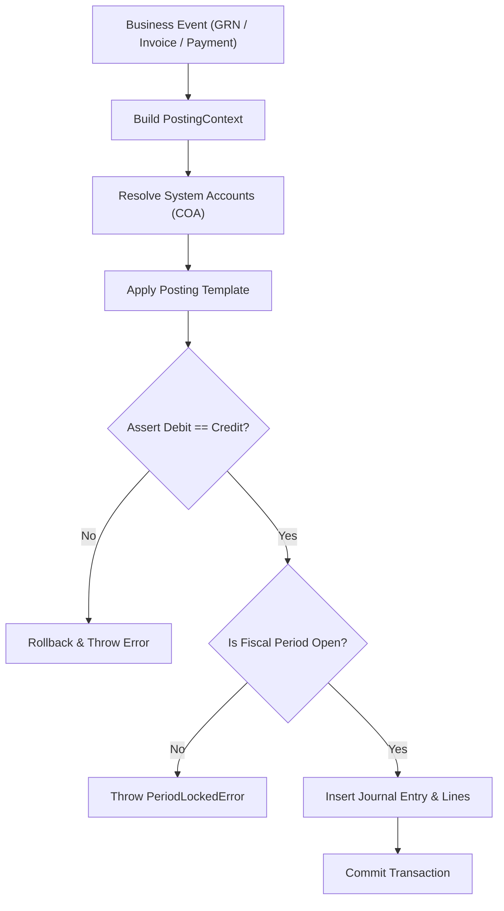

# ERP Accounting & General Ledger (GL) Skill & Bug-Fixing Runbook

Use this skill whenever working on, modifying, or diagnosing bugs in:
- Double-Entry Posting Engine & Posting Templates (`posting-templates.ts`)
- Chart of Accounts (COA) (`chart_of_accounts`)
- Journal Entries & Lines (`journal_entries`, `journal_entry_lines`)
- Financial Periods & Period Locking (`fiscal_years`, `fiscal_periods`)
- Bank Reconciliation & Statement Ingestion (GAP 10) (`bank_reconciliations`, `bank_statements`)
- Accounts Receivable (AR) & Accounts Payable (AP) Sub-Ledger Matching
- Project Accounting & Job Costing (GAP 8) (`projects`, `project_budgets`)

---

## 1. Absolute Financial Invariants

1. **Double-Entry Equilibrium:** Every posted journal entry MUST satisfy:
   $$\sum \text{Debits} = \sum \text{Credits}$$
   The posting engine must assert zero difference before writing to the database.
2. **Strict Immutability:** Journal entry lines can NEVER be updated or deleted after posting. All corrections must be posted as counter/reversal entries.
3. **Period Locking:** No document or journal entry may be posted in a period marked as `locked` or `closed` without an explicit Super-Admin override token.
4. **Append-Only Sub-Ledgers:** Customer balances (AR) and Supplier balances (AP) are derived from the posted ledger entries, never stored as independent editable totals.

---

## 2. Posting Engine & Template Architecture

All system events (Billing, Receipts, Goods Movement, Landed Costs, Payroll) pass through `PostingEngine.post(tx, ctx, userId)`.



### Posting Context Structure
```ts
interface PostingContext {
  companyId: string;
  plantId?: string;
  projectId?: string; // GAP 8: Project Accounting
  documentType: string;
  documentId: string;
  documentNumber: string;
  postingDate: Date;
  lines: Array<{
    accountId: string;
    debitPaise: number;
    creditPaise: number;
    costCentreId?: string;
    projectId?: string;
    partyType?: 'customer' | 'supplier';
    partyId?: string;
    description: string;
  }>;
}
```

---

## 3. Project Accounting & Job Costing (GAP 8)

### A. Architectural Overview
For businesses operating in civil contracting, custom machinery, infrastructure, and consulting, revenue, direct materials, subcontracting fees, and labor absorption must be tracked at the **Project Level**.

### B. Project Multi-Dimensional Posting Pattern
Whenever a transaction affects a project:
1. Inward direct purchase tagged with `projectId`:
   - Debits **Project WIP / Material Expense** tagged with `projectId`.
2. Warehouse stock issued to project:
   - **DR** Project Cost / Material Consumption (`projectId`)
   - **CR** Inventory Asset Account
3. Subcontractor invoice tagged with `projectId`:
   - **DR** Project Subcontracting Expense (`projectId`)
   - **CR** Vendor Accounts Payable
4. Milestone billing invoice:
   - **DR** Customer Accounts Receivable
   - **CR** Project Revenue (`projectId`)

### C. Live Budget vs Actual (BvA) Profitability Formula
$$\text{Project Profitability} = \text{Recognized Revenue} - (\text{Actual Materials} + \text{Actual Labor} + \text{Actual Subcontracting} + \text{Actual Overheads})$$
$$\text{Cost Variance} = \text{Budgeted Cost} - \text{Actual Cost}$$

---

## 4. Bank Reconciliation & Ingestion (GAP 10)

### Reconciliation Architecture
1. Ingest bank statement lines from CSV/API (`bank_statement_lines`).
2. Fetch un-reconciled GL lines for the associated bank ledger account.
3. Matching rules:
   - **Exact Match:** Matching Amount ($\pm 0$) and Date within tolerance window ($\le 3$ days) and matching reference/cheque number.
   - **Partial Match:** Amount matches, reference differs $\longrightarrow$ flagged for manual confirmation.
4. When confirmed:
   - Sets `journal_entry_lines.clearing_date = statement_line.date`.
   - Locks statement line from being reconciled against another entry.

---

## 5. Diagnostic Runbook for Accounting Bug Fixing

### Bug 1: Unbalanced Journal Entry Error (`Debit != Credit`)
- **Symptom:** API returns `500 Unbalanced Journal: Debits [X] != Credits [Y]`.
- **Root Causes:**
  1. Rounding discrepancies on multi-line tax calculations (paise fraction rounding).
  2. Missing discount line or rounding adjustment line.
  3. Landed cost charge apportioned with odd remainders without allocating residual paise to the last line.
- **Remediation Pattern:**
  Always allocate any division remainder paise to the final line item:
  ```ts
  let allocatedTotal = 0;
  for (let i = 0; i < lines.length; i++) {
    const isLast = i === lines.length - 1;
    const share = isLast 
      ? totalChargePaise - allocatedTotal 
      : Math.floor((lines[i].basis / totalBasis) * totalChargePaise);
    allocatedTotal += share;
    // assign share...
  }
  ```

---

### Bug 2: Backdated Entry Posted into Locked Financial Period
- **Symptom:** Audited financial reports change after financial year end.
- **Root Causes:**
  - Route handler accepted client-supplied `postingDate` without invoking `assertPeriodIsOpen(companyId, postingDate)`.
- **Remediation Rule:**
  Every transaction handler posting to GL or SLE must invoke:
  ```ts
  await app.accountingService.assertPeriodIsOpen(companyId, postingDate);
  ```

---

### Bug 3: Project Cost Report Discrepancy (Material Consumed vs Project Cost)
- **Symptom:** Stock ledger displays material issued to Project #101, but Project Accounting screen shows zero material cost.
- **Root Causes:**
  - `stock_ledger_entries.project_id` was written, but the corresponding journal entry line omitted `project_id`.
- **Remediation Rule:**
  Ensure `PostingContext.lines` maps `projectId` from the source transaction line directly into `journal_entry_lines.project_id`.

---

## 6. Security & RBAC Codes for Accounting

| Capability | Permission Code |
|---|---|
| View General Ledger | `accounting.gl.view` |
| Create Manual Journal Voucher | `accounting.jv.create` |
| Manage Chart of Accounts | `accounting.coa.manage` |
| Lock Financial Periods | `accounting.period.lock` |
| Bank Reconciliation | `accounting.bank_reconciliation.manage` |
| Project Accounting & Budgets | `accounting.project.manage` |
| Financial Reports (TB, P&L, BS) | `reports.financial.view` |

