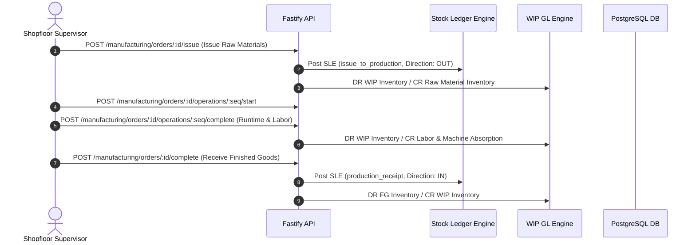

# ERP Manufacturing & Subcontracting Skill & Bug-Fixing Runbook

Use this skill whenever working on, modifying, or diagnosing bugs in:
- Dynamic Multi-Stage Routing & Shopfloor Operations
- Work Orders & Production Orders (`production_orders`)
- Bill of Materials (BOM) & Multi-Level Explosion (`bom_headers`, `bom_lines`)
- Work-in-Progress (WIP) GL Cost Absorption (Labor, Machine, Overhead)
- By-Product & Co-Product Cost Allocation Engine
- Subcontracting & Outside Job Work (GAP 4) (`job_work_orders`, outward challans, inward GRNs)

---

## 1. Manufacturing Invariants & Production Workflow Integrity

1. **Workflow Integrity:**
   $$\text{Raw Material Issue} \longrightarrow \text{Routing Operations (1..N)} \longrightarrow \text{Subcontracting (if required)} \longrightarrow \text{QC Inspection} \longrightarrow \text{Finished Goods Receipt}$$
2. **Cost Roll-Up Invariant:** Total unit cost of finished product MUST accumulate all cost components:
   $$\text{Total Cost} = \text{Raw Material Cost} + \text{Direct Labor} + \text{Machine Runtime} + \text{Packaging Material} + \text{Subcontracting Service Fee} + \text{Absorbed Overheads}$$
   *Hardcoding cost or bypassing previous stages is strictly forbidden.*
3. **No Direct Finished Goods Creation:** Finished goods cannot be artificially created without an authorized Work Order or Subcontracting GRN.

---

## 2. Dynamic Routing & Shopfloor Execution



### Routing Operation Completion Pattern
When an operation in a routing sequence completes:
1. Absorbs direct labor cost:
   $$\text{Labor Cost} = \text{Actual Labor Hours} \times \text{Work Center Hourly Labor Rate}$$
2. Absorbs machine runtime cost:
   $$\text{Machine Cost} = \text{Actual Machine Hours} \times \text{Work Center Machine Rate}$$
3. Posts balanced WIP journal entry:
   - **DR** Work-in-Progress (WIP) Asset Account
   - **CR** Labor Absorption Expense / Clearing Account
   - **CR** Machine Overhead Absorption Clearing Account

---

## 3. Subcontracting & Outside Job Work (GAP 4)

### A. Business Lifecycle
When sending materials out for processing (e.g. galvanizing, heat treatment, slitting):
1. **Job Work Order (JWO):** Defines output item, required inputs, authorized vendor, and contracted service charge.
2. **Outward Subcon Challan:**
   - Issues raw materials from internal plant warehouse to `Vendor Virtual Warehouse`.
   - `movement_type = 'subcon_issue'`.
   - Inventory remains on company's books (tagged under vendor's location).
3. **Inward Subcontracting GRN:**
   - Consumes raw materials from `Vendor Virtual Warehouse` (`movement_type = 'issue_to_production'`).
   - Receives processed output goods into `Internal Plant Warehouse` (`movement_type = 'subcon_receipt'`).
   - Valuation of output item:
     $$\text{FG Unit Cost} = \frac{\sum \text{Consumed Raw Material Costs} + \text{Total Vendor Service Charge}}{\text{Received Quantity}}$$
   - Posts balanced GL entry:
     - **DR** Finished Inventory Asset
     - **CR** Raw Material Inventory Asset (at vendor location)
     - **CR** AP Clearing / Subcontractor Service Payable

---

## 4. Key Database Tables

| Table Name | Description | File Location |
|---|---|---|
| `bom_headers` | Bill of Material parent definitions | `packages/db/src/schema/manufacturing.ts` |
| `bom_lines` | Child components, scrap percentage, and routing stages | `packages/db/src/schema/manufacturing.ts` |
| `work_centres` | Production machine and labor capacity rates | `packages/db/src/schema/manufacturing.ts` |
| `routings` | Sequence of operations required for an item | `packages/db/src/schema/manufacturing.ts` |
| `production_orders` | Execution instances of manufacturing orders | `packages/db/src/schema/manufacturing.ts` |
| `production_order_operations` | Progress tracking of shopfloor stages | `packages/db/src/schema/manufacturing.ts` |
| `job_work_orders` | Subcontracting contracts with vendors (GAP 4) | `packages/db/src/schema/manufacturing.ts` |
| `job_work_challans` | Outward material movement to vendor location | `packages/db/src/schema/manufacturing.ts` |

---

## 5. Diagnostic Runbook for Manufacturing Bug Fixing

### Bug 1: Unabsorbed WIP Hanging in General Ledger After Order Closure
- **Symptom:** A production order is closed, but the WIP account still carries an unsettled debit or credit balance.
- **Root Causes:**
  1. Material or labor was posted after the finished goods receipt was already calculated.
  2. Scrap/yield variance was not booked to `Manufacturing Variance Account`.
- **Diagnostic Query:**
  ```sql
  SELECT po.order_number, po.status,
         SUM(CASE WHEN jel.is_debit THEN jel.amount_paise ELSE -jel.amount_paise END) AS net_wip_balance
  FROM production_orders po
  JOIN journal_entries je ON je.document_id = po.id
  JOIN journal_entry_lines jel ON jel.journal_entry_id = je.id
  JOIN chart_of_accounts coa ON jel.account_id = coa.id
  WHERE coa.sub_type = 'wip_inventory'
  GROUP BY po.order_number, po.status
  HAVING SUM(CASE WHEN jel.is_debit THEN jel.amount_paise ELSE -jel.amount_paise END) != 0;
  ```
- **Remediation Pattern:** On closing a production order, any residual WIP balance must be flushed to `Manufacturing Variance Account` via a settlement journal entry.

---

### Bug 2: Subcontracting Stock Not Consumed from Vendor Warehouse
- **Symptom:** Raw materials remain in the vendor's virtual warehouse forever even though the finished goods were received.
- **Root Causes:**
  - Inward GRN posted the `subcon_receipt` for the finished good but omitted the corresponding `issue_to_production` SLE for the input materials at the vendor warehouse.
- **Remediation Pattern:** Ensure Inward Subcontracting GRN API wraps both operations in the same transaction:
  ```ts
  // 1. Consume raw materials from vendor warehouse
  await app.stockLedger.postBatch(tx, consumedRawMaterials.map(m => ({
    movementType: 'issue_to_production',
    warehouseId: jwo.vendorWarehouseId,
    quantity: m.qty,
    ...
  })));

  // 2. Receive finished item into plant warehouse
  await app.stockLedger.post(tx, {
    movementType: 'subcon_receipt',
    warehouseId: jwo.receivingWarehouseId,
    quantity: receivedQty,
    valuationRatePaise: totalCostPaise / receivedQty,
    ...
  });
  ```

---

## 6. Security & RBAC Codes for Manufacturing

| Capability | Permission Code |
|---|---|
| View Work Orders | `manufacturing.order.view` |
| Create Work Order | `manufacturing.order.create` |
| Execute Shopfloor Operations | `manufacturing.operation.execute` |
| Issue Materials | `manufacturing.material.issue` |
| Subcontracting Orders (JWO) | `manufacturing.subcon.manage` |
| Complete Production | `manufacturing.order.complete` |

---

## 7. Manufacturing Route Registry & Aliases

To prevent blank screen rendering when navigating from sidebar or deep links, all routes support both standard names and common aliases:

| Screen | Primary Route | Alias Route | Component |
|---|---|---|---|
| Formulas / BOM | `/manufacturing/bom` | `/manufacturing/formulas` | `FormulasPage` |
| Work Centres | `/manufacturing/work-centres` | `/manufacturing/work-centers` | `WorkCentresPage` |
| Process Batches | `/manufacturing/batches` | — | `ProcessBatchesPage` |
| Production Orders | `/manufacturing/orders` | — | `ProductionOrdersPage` |
| Subcontracting (Job Work) | `/manufacturing/subcontracting` | — | `SubcontractingPage` |


