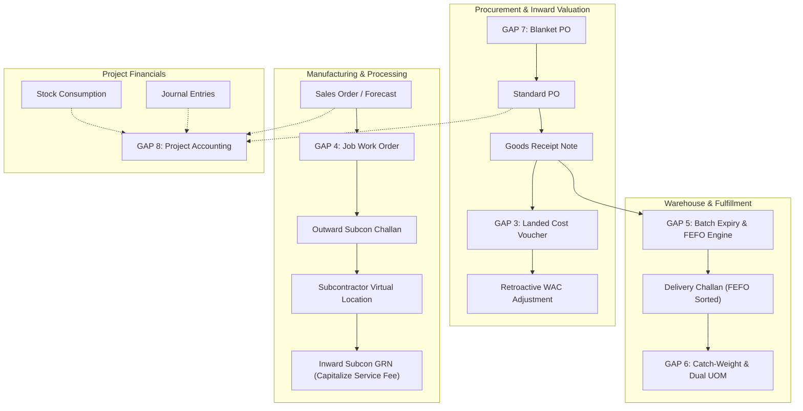

# ERP Phase 2 Master Specification & Diagnostic Runbook

Use this skill whenever developing, modifying, testing, or diagnosing bugs in any of the **Phase 2 ERP Capabilities**:
- **GAP 3:** Landed Cost Voucher (LCV)
- **GAP 8:** Project Accounting & Job Costing
- **GAP 4:** Subcontracting & Outside Job Work
- **GAP 5:** Automated FEFO & Shelf-Life Expiry Enforcer
- **GAP 6:** Multi-UOM Dual Units & Catch-Weight Management
- **GAP 7:** Blanket Purchase Orders & Long-Term Call-Off Contracts

---

## 1. Architectural Guardrails for Phase 2

All Phase 2 features must conform to the **Core ERP Invariants**:
1. **Movement-Based Inventory:** Never mutate `stock_balances.quantityOnHand` or `valuationRatePaise` directly. All quantity and valuation adjustments MUST insert immutable rows into `stock_ledger_entries` (SLE).
2. **Double-Entry Accounting:** Every financial or inventory valuation movement MUST generate a balanced Journal Voucher ($\sum \text{Debits} = \sum \text{Credits}$).
3. **Atomic Transaction Discipline:** Any operation touching inventory, accounting, or production executes inside a single database transaction (`tx`):
   $$\text{Validate} \longrightarrow \text{Lock Records (SELECT FOR UPDATE)} \longrightarrow \text{Execute Logic} \longrightarrow \text{Insert SLE} \longrightarrow \text{Insert GL} \longrightarrow \text{Audit Log} \longrightarrow \text{Commit}$$
4. **Append-Only History:** No physical deletions or updates on posted journals, ledger entries, or stock movements. Reversals must be executed via counter-entries.

---

## 2. Feature-by-Feature Deep Dive & Implementation Specs



---

### GAP 3: Landed Cost Voucher (LCV)

#### A. Purpose & Business Problem
Freight, customs duties, clearing fees, port handling charges, and transit insurance arrive after Goods Receipt Notes (GRN) are posted. Without an LCV, inventory valuations are understated, distorting Cost of Goods Sold (COGS) and gross margin calculations.

#### B. Data Model (`packages/db/src/schema/purchase.ts` or `inventory.ts`)
```ts
export const landedCostVouchers = pgTable('landed_cost_vouchers', {
  ...baseColumns,
  companyId: uuid('company_id').notNull().references(() => companies.id),
  voucherNumber: varchar('voucher_number', { length: 50 }).notNull(),
  postingDate: date('posting_date').notNull(),
  allocationBasis: varchar('allocation_basis', { length: 20 }).notNull(), // 'by_value' | 'by_qty'
  totalChargesPaise: bigint('total_charges_paise', { mode: 'number' }).notNull(),
  status: documentStatusEnum('status').default('draft').notNull(), // draft | submitted | posted | cancelled
  journalEntryId: uuid('journal_entry_id').references(() => journalEntries.id),
  notes: text('notes'),
  ...makeAuditColumns(),
});

export const lcvApplicableGrns = pgTable('lcv_applicable_grns', {
  id: uuid('id').defaultRandom().primaryKey(),
  lcvId: uuid('lcv_id').notNull().references(() => landedCostVouchers.id, { onDelete: 'cascade' }),
  grnId: uuid('grn_id').notNull().references(() => goodsReceiptNotes.id),
  grnAmountPaise: bigint('grn_amount_paise', { mode: 'number' }).notNull(),
  allocatedChargesPaise: bigint('allocated_charges_paise', { mode: 'number' }).notNull(),
});

export const lcvExpenseLines = pgTable('lcv_expense_lines', {
  id: uuid('id').defaultRandom().primaryKey(),
  lcvId: uuid('lcv_id').notNull().references(() => landedCostVouchers.id, { onDelete: 'cascade' }),
  expenseAccountId: uuid('expense_account_id').notNull().references(() => chartOfAccounts.id),
  description: varchar('description', { length: 255 }).notNull(),
  amountPaise: bigint('amount_paise', { mode: 'number' }).notNull(),
});
```

#### C. Valuation Adjustment & Accounting Posting Pattern
1. **SLE Valuation Adjustment:**
   - For each applicable GRN line:
     $$\text{Line Extra Cost} = \text{Total Landed Charge} \times \left( \frac{\text{Line Basis}}{\sum \text{Basis}} \right)$$
   - Insert an SLE with `movement_type = 'adjustment_in'`, `quantity = 0`, `valuation_rate_paise = 0`, `total_value_paise = Line Extra Cost`.
   - Update running `stock_balances.valuation_rate_paise` for the item at that warehouse:
     $$\text{New WAC} = \frac{\text{Current Total Value} + \text{Line Extra Cost}}{\text{Current Quantity On Hand}}$$
2. **GL Voucher:**
   - **DR** Inventory Asset Account (Asset increased by extra landed valuation)
   - **CR** Landed Cost Clearing / Freight Payable Account (Liability / Clearing)

---

### GAP 8: Project Accounting & Job Costing

#### A. Purpose & Business Problem
Businesses executing civil works, engineering contracts, machinery fabrication, or consulting need to track revenues, direct material issues, contractor costs, and labor against discrete **Projects** (Jobs), comparing Budget vs Actual (BvA) in real time.

#### B. Data Model (`packages/db/src/schema/accounting.ts`)
```ts
export const projects = pgTable('projects', {
  ...baseColumns,
  companyId: uuid('company_id').notNull().references(() => companies.id),
  code: varchar('code', { length: 50 }).notNull(),
  name: varchar('name', { length: 255 }).notNull(),
  customerId: uuid('customer_id').references(() => customers.id),
  contractValuePaise: bigint('contract_value_paise', { mode: 'number' }).notNull().default(0),
  budgetMaterialPaise: bigint('budget_material_paise', { mode: 'number' }).notNull().default(0),
  budgetLaborPaise: bigint('budget_labor_paise', { mode: 'number' }).notNull().default(0),
  budgetSubconPaise: bigint('budget_subcon_paise', { mode: 'number' }).notNull().default(0),
  budgetOverheadPaise: bigint('budget_overhead_paise', { mode: 'number' }).notNull().default(0),
  startDate: date('start_date'),
  endDate: date('end_date'),
  status: varchar('status', { length: 30 }).default('active').notNull(), // planning | active | on_hold | completed | closed
  costCentreId: uuid('cost_centre_id').references(() => costCentres.id),
  ...makeAuditColumns(),
});
```

#### C. Tagging & Profitability Tracking
- Add `projectId: uuid('project_id').references(() => projects.id)` to:
  - `sales_orders`, `sales_invoices` (Revenue)
  - `purchase_orders`, `purchase_invoices` (Direct Procurement)
  - `stock_ledger_entries` (Material Consumption)
  - `journal_entry_lines` (Direct Expense & Labor allocation)
- Dedicated Screen: [ProjectAccounting.tsx](file:///Users/shyam18/SEGA/ERP/apps/web/src/pages/accounting/ProjectAccounting.tsx)
  - BvA Dashboard: Material Actual vs Budget, Labor Actual vs Budget, Subcontracting Actual vs Budget.
  - Live Margin: $\text{Billed Revenue} - \text{Total Incurred Actual Costs}$.

---

### GAP 4: Subcontracting & Outside Job Work

#### A. Purpose & Business Problem
Sending raw materials or sub-assemblies to outside vendors for specialized processes (e.g. powder coating, heat treatment, slitting) and receiving processed assemblies back while tracking:
1. Vendor stock holding (stock belongs to company but sits at vendor site).
2. Processing / service fee capitalization into unit cost.

#### B. Data Model (`packages/db/src/schema/manufacturing.ts`)
```ts
export const jobWorkOrders = pgTable('job_work_orders', {
  ...baseColumns,
  companyId: uuid('company_id').notNull().references(() => companies.id),
  orderNumber: varchar('order_number', { length: 50 }).notNull(),
  vendorId: uuid('vendor_id').notNull().references(() => suppliers.id),
  vendorWarehouseId: uuid('vendor_warehouse_id').notNull().references(() => warehouses.id),
  targetItemId: uuid('target_item_id').notNull().references(() => items.id),
  targetQty: numeric('target_qty', { precision: 18, scale: 4 }).notNull(),
  uom: varchar('uom', { length: 20 }).notNull(),
  serviceRatePaise: bigint('service_rate_paise', { mode: 'number' }).notNull(),
  status: documentStatusEnum('status').default('draft').notNull(), // draft | issued | partially_received | completed | cancelled
  ...makeAuditColumns(),
});
```

#### C. Stock & Financial Flow
1. **Outward Challan (Issue to Vendor):**
   - Stock moves from `Internal Warehouse` to `Vendor Virtual Warehouse`.
   - `movement_type = 'subcon_issue'`, stock remains on company balance sheet.
2. **Inward GRN (Finished Goods Receipt):**
   - Consumes raw materials from `Vendor Virtual Warehouse` (`movement_type = 'issue_to_production'`).
   - Receives target finished item into `Internal Warehouse` (`movement_type = 'subcon_receipt'`).
   - Unit Cost of received item = $\text{Consumed Raw Material Value} + \text{Vendor Service Charge}$.
   - Posts balanced GL:
     - **DR** Inventory Asset (Target Item at full capitalized cost)
     - **CR** Inventory Asset (Raw Materials consumed from vendor location)
     - **CR** AP Clearing / Vendor Payable (Processing Service fee)

---

### GAP 5: Automated FEFO & Shelf-Life Expiry Enforcer

#### A. Purpose & Business Problem
Prevent dispatching expired or near-expiry batches to customers. Enforce First-Expiry-First-Out picking algorithmically.

#### B. Implementation Rules
1. **Batch Validation:**
   - Any transaction with a batch-tracked item checks:
     $$\text{expiryDate} > \text{postingDate}$$
   - If `customer.min_shelf_life_days` is configured, verify:
     $$\text{expiryDate} \ge \text{dispatchDate} + \text{minShelfLifeDays}$$
2. **Auto-Allocation Engine:**
   - In Delivery Challans or Picking Lists:
     ```sql
     SELECT batch_id, quantity_on_hand, expiry_date 
     FROM stock_balances sb
     JOIN item_batches ib ON sb.batch_id = ib.id
     WHERE sb.item_id = $itemId AND sb.warehouse_id = $warehouseId AND sb.quantity_on_hand > 0
     ORDER BY ib.expiry_date ASC, ib.created_at ASC
     FOR UPDATE OF sb;
     ```
   - Automatically allocates oldest non-expired batches until required quantity is satisfied.

---

### GAP 6: Multi-UOM Dual Units & Catch-Weight Management

#### A. Purpose & Business Problem
Items sold or stocked in pieces/slabs/bundles where actual weight varies per unit and billing is done on actual weight (e.g., steel rods, stone slabs, meat, agricultural crates).

#### B. Implementation Rules
1. `items` table schema carries:
   - `stockUom` (e.g. `PCS`, `SLAB`)
   - `secondaryUom` (e.g. `KG`, `MT`)
   - `isCatchWeight: boolean` (default false)
   - `nominalConversionFactor: numeric` (e.g. 1 PCS nominally = 25.5 KG)
   - `catchWeightTolerancePct: numeric` (e.g. 10%)
2. Transaction lines (`grn_lines`, `delivery_note_lines`, `invoice_lines`) store:
   - `primaryQty` (Stocking units — updates physical SLE)
   - `secondaryQty` (Actual weight — used for pricing & billing)
   - Validation checks that actual ratio does not violate `catchWeightTolerancePct` unless overridden by supervisor.

---

### GAP 7: Blanket Purchase Orders & Call-Off Contracts

#### A. Purpose & Business Problem
Securing annual pricing and quantity volume commitments from suppliers, releasing them via scheduled purchase orders over time.

#### B. Implementation Rules
1. `blanket_purchase_orders` contains `validFrom`, `validTo`, `totalCommittedQty`, `lockedRatePaise`.
2. Standard `purchase_orders` include optional `blanketPoId`.
3. When a release PO is submitted:
   - Validates `currentDate` is between `validFrom` and `validTo`.
   - Validates `po.unitPricePaise == blanketPo.lockedRatePaise`.
   - Atomically increments `blanket_po_lines.released_qty`.
   - Prevents `released_qty > committed_qty` unless blanket PO explicitly permits over-draw.

---

## 3. Bug-Fixing Diagnostic Runbook for Phase 2

### Diagnostic Tree 1: Landed Cost Voucher Not Updating Stock Valuation
1. **Symptom:** LCV is posted, but item valuation rate on subsequent dispatches does not reflect the landed freight.
2. **Cause Check:**
   - Did LCV insert an SLE with `movement_type = 'adjustment_in'`?
   - Was `stock_balances` row locked (`SELECT FOR UPDATE`) during recalculation?
   - Check formula: If `quantity_on_hand == 0` when LCV is posted, the extra cost cannot attach to non-existent inventory. It must be written off to a `COGS Landed Cost Variance` expense account instead of hanging.
3. **Fix Action:**
   ```sql
   -- Verify SLE exists
   SELECT * FROM stock_ledger_entries WHERE document_type = 'purchase.lcv' AND document_id = '<lcv-id>';
   ```

### Diagnostic Tree 2: FEFO Allocating Wrong Batches
1. **Symptom:** Delivery Challan picks newer batches while older batches remain in warehouse.
2. **Cause Check:**
   - Check if `item_batches.expiry_date` is populated or `NULL`. `NULL` expiry dates sort unpredictably without `NULLS LAST`.
   - Check if reservation engine respects batch status (e.g. `qc_status == 'approved'`).
3. **Fix Action:**
   - Ensure query has `ORDER BY ib.expiry_date ASC NULLS LAST`.

### Diagnostic Tree 3: Subcontracting Inventory Mismatch at Vendor Location
1. **Symptom:** Inward Subcontracting GRN fails with `Insufficient stock at vendor warehouse`.
2. **Cause Check:**
   - Verify that Outward Challan completed and created `subcon_issue` SLE targeting the vendor's virtual warehouse ID.
   - Verify that the vendor warehouse ID on the JWO matches the vendor warehouse on the Inward GRN.

---

## 4. Phase 2 Verification Checklist
Before declaring any Phase 2 feature complete, verify:
- [ ] Database migrations applied cleanly with no down-migrations or destructive DDL.
- [ ] Zod schema validators present in `@erp/shared`.
- [ ] Fastify route endpoints protected by `resolveTenantContext` and `authorize(...)`.
- [ ] Single DB transaction wraps `Validate -> Lock -> SLE -> GL -> Audit -> Commit`.
- [ ] React UI pages use Tailwind CSS dual-theme (`dark:`) and Lucide icons.
- [ ] `pnpm turbo build` completes with 4 successful packages.

