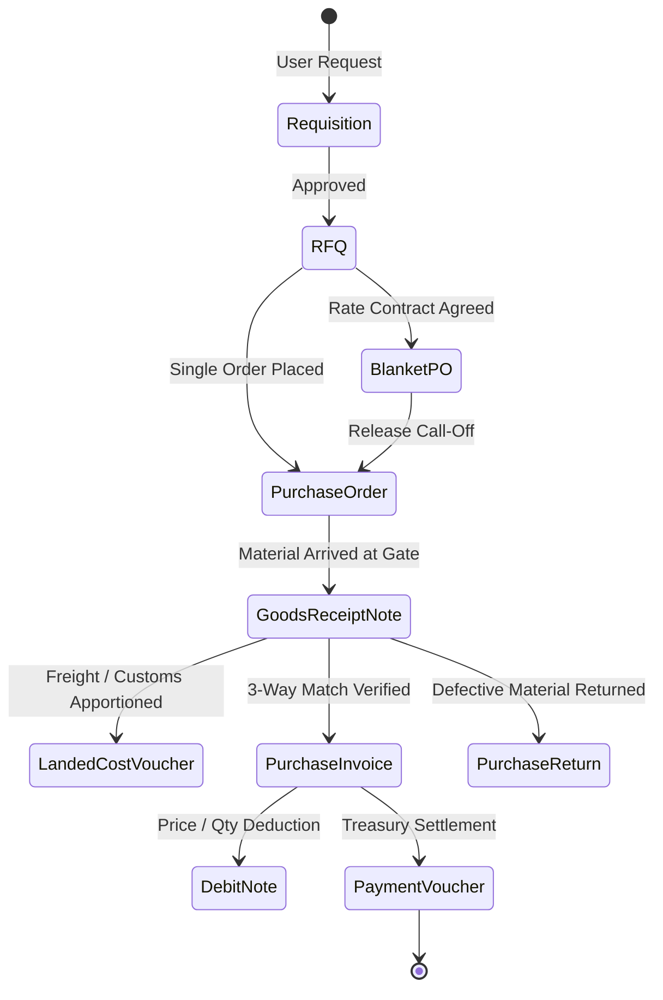

# ERP Procure-to-Pay (P2P) Skill & Bug-Fixing Runbook

Use this skill whenever working on, modifying, or troubleshooting any component in the **Procure-to-Pay (P2P)** pipeline:
- Purchase Requisitions (`purchase_requisitions`)
- Blanket Purchase Orders (`blanket_purchase_orders`) — GAP 7
- Purchase Orders (`purchase_orders`, `purchase_order_lines`)
- Goods Receipt Notes (`goods_receipt_notes`, `grn_lines`)
- Landed Cost Vouchers (`landed_cost_vouchers`) — GAP 3
- Purchase Invoices / Bills (`purchase_invoices`, `purchase_invoice_lines`)
- Purchase Returns (RTV) (`purchase_returns`, `purchase_return_lines`)
- Debit Notes (`debit_notes`)
- Vendor Payments & Advances (`payment_vouchers`)

---

## 1. P2P Document Lifecycle & Status State Machine



### Document Status Engine Rules
Every P2P document inherits the standard workflow state transition:
- `draft` $\longrightarrow$ `submitted` $\longrightarrow$ `approved` $\longrightarrow$ `partially_received` / `completed`
- Cancellation is ONLY allowed from `draft` or `submitted`.
- Once `approved` or `posted`, cancellation requires an explicit reversal document (e.g. Return to Vendor or Reversal Journal).

---

## 2. Invariant Accounting & Movement Patterns

### Step 1: Goods Receipt Note (GRN) Approval
When physical goods enter the warehouse:
1. **Stock Movement:**
   - Appends row to `stock_ledger_entries`:
     - `movement_type = 'purchase_receipt'` (Direction: `IN`)
     - `valuation_rate_paise = grn_line.unit_price_paise`
   - Atomically updates running `stock_balances` and Weighted Average Cost (WAC).
2. **General Ledger Entry:**
   - **DR** Inventory Asset Account (Stock in Hand at current WAC)
   - **CR** Accounts Payable Clearing Account (GRN Clearing / Unbilled Inward Liability)

### Step 2: Landed Cost Voucher (LCV)
When freight, customs, or handling bills arrive:
1. **Stock Movement:**
   - Inserts valuation-only SLE (`adjustment_in`, `qty = 0`, `valuation_rate = 0`, `total_value_paise = apportioned_amount`).
   - Recalculates running WAC on `stock_balances`.
2. **General Ledger Entry:**
   - **DR** Inventory Asset Account
   - **CR** Freight / Customs Payable Account

### Step 3: Purchase Invoice (Bill) Posting
When the vendor's tax invoice arrives:
1. **General Ledger Entry:**
   - **DR** AP Clearing Account (clears the liability created during GRN)
   - **DR** Input GST Tax Accounts (CGST, SGST, IGST)
   - **CR** Vendor Accounts Payable Account
   - **CR** TDS Payable Account (if section 194Q or 194C applies)
2. **Price Variance Handling:**
   If invoice rate differs from GRN valuation rate:
   - Difference is booked to **Purchase Price Variance (PPV)** expense account.

### Step 4: Purchase Return (Return to Vendor - RTV)
When rejected material is shipped back:
1. **Stock Movement:**
   - `movement_type = 'return_to_vendor'` (Direction: `OUT`).
   - Issues stock at current WAC.
2. **General Ledger Entry:**
   - **DR** AP Clearing / Vendor Account
   - **CR** Inventory Asset Account

---

## 3. Key Database Tables & Schemas

| Table Name | Primary Purpose | File Location |
|---|---|---|
| `purchase_requisitions` | Department internal material requests | `packages/db/src/schema/purchase.ts` |
| `blanket_purchase_orders` | Long-term annual rate & volume contracts | `packages/db/src/schema/purchase.ts` |
| `blanket_po_lines` | Item breakdown & remaining balance for blanket contracts | `packages/db/src/schema/purchase.ts` |
| `purchase_orders` | Authorized procurement contracts with vendors | `packages/db/src/schema/purchase.ts` |
| `purchase_order_lines` | Line quantities, rates, taxes, and project links | `packages/db/src/schema/purchase.ts` |
| `goods_receipt_notes` | Physical inward gate receipt | `packages/db/src/schema/purchase.ts` |
| `grn_lines` | Received quantities, batch/serial mappings, landed rates | `packages/db/src/schema/purchase.ts` |
| `landed_cost_vouchers` | Apportionment of freight and customs duties | `packages/db/src/schema/purchase.ts` |
| `purchase_invoices` | Vendor billing, 3-way match, AP liability | `packages/db/src/schema/purchase.ts` |
| `purchase_returns` | Goods returned to supplier | `packages/db/src/schema/purchase.ts` |
| `debit_notes` | Adjustments / deductions against vendor bills | `packages/db/src/schema/purchase.ts` |

---

## 4. Diagnostic Runbook for P2P Bug Fixing

### Bug 1: AP Clearing Account Does Not Zero Out (Trial Balance Drift)
- **Symptom:** The AP Clearing account (Unbilled GRN) has a persistent debit or credit balance that does not balance against posted bills.
- **Root Causes:**
  1. Quantity mismatch: Invoice was posted for more or fewer units than the GRN without creating a debit note or quantity adjustment.
  2. Rate variance posted directly to AP Clearing instead of Purchase Price Variance (PPV).
  3. Invoice posted without referencing `grn_id`.
- **Diagnostic Query:**
  ```sql
  SELECT grn.document_number, grn.total_amount_paise, 
         pi.document_number as invoice_number, pi.total_amount_paise as invoice_amount
  FROM goods_receipt_notes grn
  LEFT JOIN purchase_invoices pi ON pi.grn_id = grn.id
  WHERE grn.status = 'approved' AND (pi.id IS NULL OR grn.total_amount_paise != pi.subtotal_paise);
  ```
- **Fix Pattern:** Ensure `posting-templates.ts` maps unbilled GRN liabilities using the original GRN valuation rate, posting delta to `purchase_price_variance_account_id`.

---

### Bug 2: Blanket PO Released Quantity Exceeds Total Committed Limit
- **Symptom:** Purchase Orders are successfully created beyond the agreed blanket contract quantity.
- **Root Causes:**
  - Concurrent PO submissions creating a race condition without `SELECT FOR UPDATE` on `blanket_po_lines`.
  - Missing check on `valid_to` contract expiration date.
- **Diagnostic & Fix:**
  In `apps/api/src/routes/purchase.ts`, enforce strict lock:
  ```ts
  const [bpoLine] = await tx
    .select()
    .from(blanketPoLines)
    .where(eq(blanketPoLines.id, line.blanketPoLineId))
    .for('update');

  if (Number(bpoLine.releasedQty) + Number(line.quantity) > Number(bpoLine.committedQty)) {
    throw new Error(`Blanket PO quota exceeded for line item ${bpoLine.id}`);
  }
  ```

---

### Bug 3: Purchase Return Allowed Despite Insufficient Stock
- **Symptom:** RTV is approved when stock on hand is less than the return quantity, driving inventory into negative.
- **Root Causes:**
  - Client validated stock on UI, but backend omitted atomic `getAvailableQty` check inside the database transaction.
- **Fix Rule:**
  Always invoke `app.stockLedger.getAvailableQty(companyId, warehouseId, itemId)` inside `tx` immediately before posting `subcon_issue` or `return_to_vendor`.

---

## 5. Security & RBAC Codes for P2P

| Capability | Permission Code |
|---|---|
| View Purchase Orders | `purchase.po.view` |
| Create Purchase Order | `purchase.po.create` |
| Approve Purchase Order | `purchase.po.approve` |
| View GRN | `purchase.grn.view` |
| Post GRN | `purchase.grn.create` |
| Landed Cost Voucher | `purchase.lcv.manage` |
| Purchase Invoices | `purchase.invoice.view`, `purchase.invoice.create` |
| Purchase Returns | `purchase.return.manage` |
| Blanket Contracts | `purchase.blanket_po.manage` |

