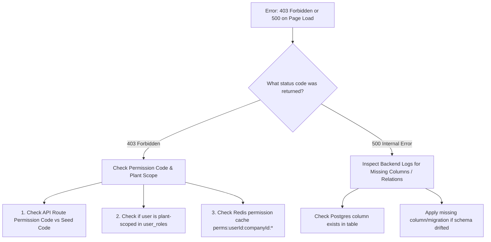

# ERP RBAC, Tenant Scoping & Master Loading Diagnostic Runbook

Use this skill whenever investigating:
- `403 Forbidden` errors on navigation or API requests (Quotations, Sales Orders, Purchase Orders, Suppliers, Customers, etc.)
- "Failed to load customers / suppliers / masters" messages in the frontend
- Missing permission errors or empty permission arrays for active users
- Plant-scoped access vs company-wide role resolution issues

---

## 1. Architecture Fundamentals: How Permissions & Scopes Work

### A. Context-Bound Session Architecture
- The frontend **never sends client-supplied `x-company-id` or `x-plant-id` headers** on normal data requests.
- Instead, upon login and company/plant selection (`/api/auth/select-context`):
  1. The server validates that the user belongs to the company and has plant access.
  2. The server updates `sessions.activeCompanyId` and `sessions.activePlantId`.
  3. The server issues a JWT token containing:
     ```json
     {
       "sub": "user-uuid",
       "sessionId": "session-uuid",
       "activeCompanyId": "company-uuid",
       "activePlantId": "plant-uuid"
     }
     ```
  4. The preHandler `resolveTenantContext` extracts this validated context into `request.tenant`:
     ```ts
     request.tenant = {
       companyId: user.activeCompanyId,
       activePlantId: user.activePlantId ?? null,
       sessionId: user.sessionId,
       isSystemAdmin: user.isSystemAdmin,
     };
     ```

### B. Plant Scoping & Permission Resolution Rule
- When `user_roles` assigns a role to a user with a `plant_id` (e.g. `user_roles.plant_id = 'plant-uuid'`), that role is **plant-scoped**.
- In `PermissionService.compute(userId, companyId, plantId)`:
  ```ts
  const plantCondition = plantId
    ? or(isNull(userRoles.plantId), eq(userRoles.plantId, plantId))
    : isNull(userRoles.plantId);
  ```
  - **CRITICAL**: If `plantId` is `undefined`, it evaluates only `isNull(userRoles.plantId)`!
  - Therefore, any request where `plantId` is missing will return **0 permissions** for users with plant-scoped roles unless `plantId` falls back to `request.tenant.activePlantId`.
- **Mandatory Authorize Pattern** ([apps/api/src/middleware/authorize.ts](file:///Users/shyam18/SEGA/ERP/apps/api/src/middleware/authorize.ts)):
  ```ts
  const plantId: string | undefined = opts?.plantFrom
    ? get(request, opts.plantFrom)
    : (request.headers['x-plant-id'] as string | undefined) ??
      (request as any).plantId ??
      get(request, 'body.plantId') ??
      get(request, 'params.plantId') ??
      (request.query as any)?.plantId ??
      request.tenant?.activePlantId ??
      (request.user as any)?.activePlantId ??
      undefined;
  ```

---

## 2. Step-by-Step Diagnostic Flow

When an endpoint or page returns `403 Forbidden` or `Failed to load`:



### Step 1: Check Backend Logs
Check the Fastify API background task log (`.system_generated/tasks/task-*.log` or terminal output):
- Look for `detail: "Missing permission: ..."`
- Or `PostgresError: column "xyz" does not exist`

### Step 2: Check Permission Mismatches
Verify that the permission code in the route matches the official seed in [packages/db/src/seeds/permissions.ts](file:///Users/shyam18/SEGA/ERP/packages/db/src/seeds/permissions.ts):
- **Common Mistake**: Checking `sales.so.view` or `settings.company.edit` on customer routes.
  - Correct Customer codes: `sales.customer.view`, `sales.customer.create`, `sales.customer.edit`
- **Common Mistake**: Checking `purchase.po.view` or `settings.company.edit` on supplier routes.
  - Correct Supplier codes: `purchase.supplier.view`, `purchase.supplier.create`, `purchase.supplier.edit`
- Masters routes: [apps/api/src/routes/masters.ts](file:///Users/shyam18/SEGA/ERP/apps/api/src/routes/masters.ts)
- Business routes: [apps/api/src/routes/sales.ts](file:///Users/shyam18/SEGA/ERP/apps/api/src/routes/sales.ts) and [apps/api/src/routes/purchase.ts](file:///Users/shyam18/SEGA/ERP/apps/api/src/routes/purchase.ts)

### Step 3: Verify Role & Plant Assignment in DB
Run quick SQL query:
```bash
docker exec erp-postgres-1 psql -U erp -d erp_db -c "
SELECT ur.id, u.email, r.name as role, ur.company_id, ur.plant_id 
FROM user_roles ur 
JOIN users u ON ur.user_id = u.id 
JOIN roles r ON ur.role_id = r.id 
WHERE u.email = '<target-email>';
"
```
- If `ur.plant_id` is NOT NULL: The user has a **plant-scoped role**.
- Check if `request.tenant.activePlantId` matches `ur.plant_id`.
- Ensure `/api/auth/permissions` receives or falls back to `activePlantId`.

### Step 4: Flush Redis Cache After Any Role/Permission Update
Permission results are cached in Redis under `perms:<userId>:<companyId>:<plantId|all>` for 5 minutes (`CACHE_TTL = 300`).
If roles or code were changed, flush the cache:
```bash
docker exec erp-redis-1 redis-cli FLUSHALL
```

### Step 5: Check Drizzle Schema vs Postgres DB Sync
If `500 Internal Server Error` occurs with `PostgresError: column "xyz" does not exist`:
1. Check the Drizzle schema in [packages/db/src/schema/](file:///Users/shyam18/SEGA/ERP/packages/db/src/schema/).
2. Inspect table columns in PostgreSQL:
   ```bash
   docker exec erp-postgres-1 psql -U erp -d erp_db -c "\d <table_name>"
   ```
3. If new columns were added to the TypeScript schema but not yet migrated in the DB (e.g. `price_list_id` on `customers`), apply the non-breaking DDL addition directly:
   ```sql
   ALTER TABLE <table_name> ADD COLUMN IF NOT EXISTS <column_name> <type> ...;
   ```

---

## 3. Quick Self-Verification Script
Run a lightweight verification check to test login, context selection, permissions, and all module endpoints:

```bash
node -e "
(async () => {
  const base = 'http://localhost:3000/api';
  const login = await (await fetch(base + '/auth/login', {
    method: 'POST',
    headers: { 'Content-Type': 'application/json' },
    body: JSON.stringify({ email: '<email>', password: '<password>' })
  })).json();
  
  const ctx = await (await fetch(base + '/auth/select-context', {
    method: 'POST',
    headers: { 'Content-Type': 'application/json', Authorization: 'Bearer ' + login.accessToken },
    body: JSON.stringify({ companyId: '<companyId>', plantId: '<plantId>' })
  })).json();
  
  const headers = { Authorization: 'Bearer ' + ctx.accessToken };
  const endpoints = ['/sales/quotations', '/sales/orders', '/purchase/orders', '/sales/customers'];
  for (const ep of endpoints) {
    const res = await fetch(base + ep, { headers });
    console.log(ep, res.status);
  }
})();
"
```

---

## 4. Multi-User State Isolation & Complete Session Teardown on Logout

### A. The Cross-Tenant / Cross-Company Residue Bug
When User 1 logs out and User 2 (belonging to a different company or plant) logs in on the same browser session:
1. `sessionStorage` previously persisted `erp-plant` (`usePlantStore`), keeping User 1's company and plant.
2. `useWorkspaceStore` tabs (`tabs: [...]`) remained in memory, causing User 2 to see User 1's open screen tabs (e.g. `/purchase/blanket-orders`, `/sales/deliveries`).
3. `usePermissionStore` cached permissions from User 1.

### B. The Mandatory Clean Teardown Invariant
In `apps/web/src/store/auth.ts`:
```ts
export function resetAllStores() {
  try {
    usePlantStore.getState().clear();
    useWorkspaceStore.getState().closeAll();
    usePermissionStore.setState({ permissions: [], isLoading: false });
    sessionStorage.removeItem('erp-plant');
    sessionStorage.clear();
  } catch {}
}
```
`resetAllStores()` MUST be executed:
- On `logout()`
- On `clearAuth()` (e.g. 401 refresh token expiration in `api/client.ts`)
- At the start of `login()` to purge any residual state before storing new user tokens
- On `selectCompany()` and `selectPlant()` to close all previous workspace tabs

---

## 5. ERP Non-Negotiable Constraints Checklist
- [x] **Movement-based inventory intact**: Never update stock quantities directly.
- [x] **Accounting integrity intact**: Debit = Credit, never bypass journal generation.
- [x] **Transaction isolation**: Atomic commits in domain transactions.
- [x] **Security / RLS**: Always use `resolveTenantContext` and `authorize(...)`. Never expose service role keys.
- [x] **Feature isolation**: Only touch defective logic; do not refactor unrelated modules.
- [x] **Session isolation**: Clean teardown of all stores on user logout/switch to prevent cross-tenant contamination.
