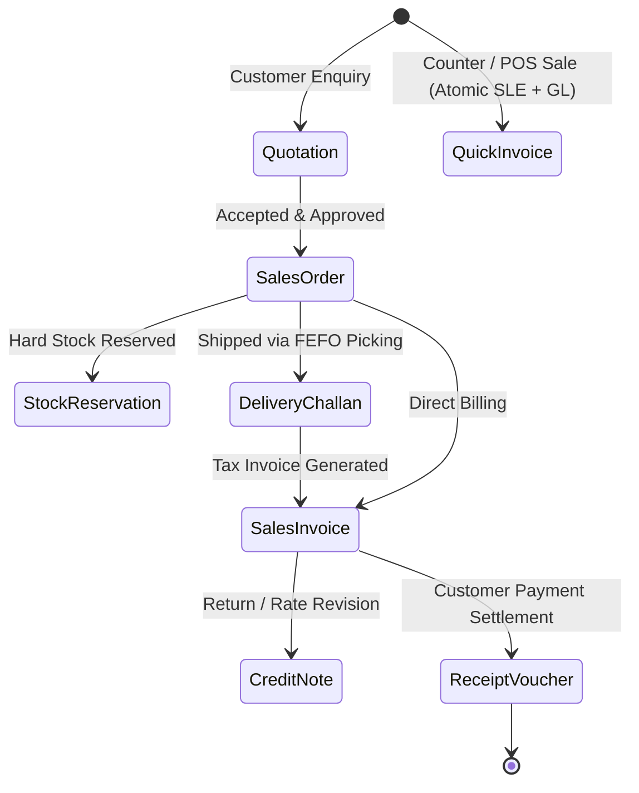

# ERP Order-to-Cash (O2C) Skill & Bug-Fixing Runbook

Use this skill whenever working on, modifying, or diagnosing bugs in:
- Quotations & Sales Approvals (`sales_quotations`)
- Sales Orders & Contract Commitments (`sales_orders`, `sales_order_lines`)
- Stock Reservation Engine (`stock_reservations`)
- Delivery Challans / Notes (`delivery_notes`, `delivery_note_lines`)
- Automated FEFO Batch Dispatch (GAP 5)
- Dual-UOM Catch-Weight Billing (GAP 6)
- Sales Invoices & Revenue Recognition (`sales_invoices`, `sales_invoice_lines`)
- Quick Invoice / Direct Counter POS (`POST /api/sales/quick-invoice`)
- Sales Returns & Credit Notes (`credit_notes`, `sales_returns`)
- Customer Receipts & Advances (`receipt_vouchers`)

---

## 1. O2C Lifecycle & Document State Machine



---

## 2. Invariant Accounting & Movement Patterns

### Step 1: Sales Order Approval & Reservation
- Does NOT move physical stock or affect GL balances.
- Inserts row into `stock_reservations`:
  $$\text{Available Qty} = \text{Quantity On Hand} - \sum \text{Active Reservations}$$
- Guarantees stock is held exclusively for this customer.

### Step 2: Delivery Challan (Dispatch)
When goods physically leave the facility:
1. **Stock Movement:**
   - Evaluates FEFO batch picking order (GAP 5).
   - Inserts row into `stock_ledger_entries`:
     - `movement_type = 'sales_delivery'` (Direction: `OUT`).
     - Snaps unit valuation rate from current WAC.
   - Clears corresponding row in `stock_reservations`.
2. **General Ledger Entry:**
   - **DR** Cost of Goods Sold (COGS) Expense Account (at snapped WAC)
   - **CR** Inventory Asset Account (at snapped WAC)

### Step 3: Sales Invoice Posting
When the tax invoice is posted to the customer:
1. **General Ledger Entry:**
   - **DR** Customer Accounts Receivable (Gross Invoice Amount)
   - **CR** Sales Revenue Account (Net Amount)
   - **CR** Output GST Accounts (CGST, SGST, IGST)
   - **CR/DR** Round-Off Expense/Gain

### Step 4: Quick Invoice / Counter POS (Zoho-Style Single Screen)
For over-the-counter sales, cash-and-carry, or quick retail:
- Executes Steps 1, 2, and 3 **atomically in a single database transaction**:
  1. Deducts physical stock at current WAC (`movement_type = 'sales_delivery'`).
  2. Creates customer receipt or cash voucher.
  3. Posts combined GL voucher (Cash/AR + COGS + Inventory + Revenue + Taxes).

---

## 3. Diagnostic Runbook for O2C Bug Fixing

### Bug 1: Ghost Stock Reservation (Stock Locked After Order Cancellation)
- **Symptom:** Item has 50 units on hand, but `availableQty` shows 0 units even though no open orders exist.
- **Root Causes:**
  - A Sales Order was cancelled or deleted without releasing rows in `stock_reservations`.
- **Diagnostic Query:**
  ```sql
  SELECT sr.id, sr.document_id, sr.item_id, sr.quantity, so.order_number, so.status
  FROM stock_reservations sr
  LEFT JOIN sales_orders so ON sr.document_id = so.id
  WHERE so.status IN ('cancelled', 'completed') OR so.id IS NULL;
  ```
- **Remediation Pattern:** Ensure cancellation handler executes:
  ```ts
  await tx.delete(stockReservations).where(eq(stockReservations.documentId, orderId));
  ```

---

### Bug 2: COGS Recognized Twice (Delivery Note + Sales Invoice)
- **Symptom:** Cost of Goods Sold is doubled on the Profit & Loss statement.
- **Root Causes:**
  - Both `delivery_notes` handler and `sales_invoices` handler posted inventory-to-COGS entries for the same order lines.
- **Remediation Rule:**
  If an invoice is linked to an existing `delivery_note_id`, the invoice MUST ONLY post AR, Revenue, and Taxes. COGS is posted ONLY at the physical dispatch stage (`delivery_notes`).

---

### Bug 3: Customer Credit Limit Violation Under Concurrent Orders
- **Symptom:** A customer with a ₹5,00,000 credit limit places two ₹4,00,000 orders simultaneously, both succeed.
- **Root Causes:**
  - Credit limit check calculated outstanding balance without row-locking the `customers` row.
- **Remediation Pattern:**
  Acquire `SELECT FOR UPDATE` on `customers` row inside the transaction:
  ```ts
  const [customer] = await tx
    .select()
    .from(customers)
    .where(eq(customers.id, order.customerId))
    .for('update');
  
  const currentOutstanding = await calculateCustomerOutstanding(tx, customer.id);
  if (currentOutstanding + orderTotal > customer.creditLimitPaise) {
    throw new Error('Credit limit exceeded');
  }
  ```

---

## 4. Security & RBAC Codes for Sales

| Capability | Permission Code |
|---|---|
| View Quotations | `sales.quotation.view` |
| Create Quotation | `sales.quotation.create` |
| View Sales Orders | `sales.so.view` |
| Approve Sales Order | `sales.so.approve` |
| Dispatch Delivery Challan | `sales.delivery.create` |
| Quick Invoice / Counter POS | `sales.invoice.quick_create` |
| Sales Invoices | `sales.invoice.view`, `sales.invoice.create` |
| Credit Notes & Returns | `sales.credit_note.manage` |
| Customer Master Management | `sales.customer.view`, `sales.customer.create`, `sales.customer.edit` |

