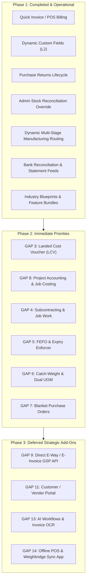

# Kairo ERP — Comprehensive Product Roadmap & Pending Gaps

**Document Status:** Active Engineering & Product Backlog  
**Version:** 2.0  
**Updated:** November 2026  
**System Architecture:** Modular Monolith with Dynamic Industry Blueprints  

---

## 1. Executive Summary & Core ERP Philosophy

Kairo ERP is designed as a mission-critical, multi-industry business operating platform. Every feature—both implemented and pending—must strictly adhere to the following **Five Non-Negotiable Invariants**:

1. **Movement-Based Inventory:** Stock balances are strictly derived from append-only `stock_ledger_entries`. Stock quantities are never mutated directly; deletions and in-place updates are prohibited.
2. **Double-Entry Financial Accounting:** Every inventory movement, billing event, and payment writes balanced double-entry journal vouchers ($\sum \text{Debits} = \sum \text{Credits}$). Posted ledger lines are immutable; adjustments must be executed via reversal entries.
3. **Multi-Stage Cost Roll-Up:** Valuations and costs dynamically roll up across raw materials, machine runtimes, direct labor absorption, packaging materials, and freight/landed charges.
4. **Atomic Transaction Discipline:** Any operation modifying inventory, accounting, or production executes in a single database transaction with ACID isolation (`Validate → Lock → Execute → SLE Insert → GL Insert → Audit Log → Commit`).
5. **Configurable Modularity (No Microservice Sprawl):** Multi-industry customization is achieved via **Dynamic Industry Blueprints** and runtime module licensing rather than splitting into fragmented microservices or maintaining divergent code branches.

---

## 2. Completed Capabilities (Delivered & Verified)

The following modules and gap resolutions have been fully implemented, integrated into the database, exposed via Fastify APIs, surfaced in React frontends, and verified clean (`turbo build: 4 successful, 4 total`):

| Module / Capability | Target Problem Solved | Key Deliverables & Routes |
|---|---|---|
| **Landed Cost Voucher (LCV)** (GAP 3) | Apportions post-GRN freight, customs, and transit fees to inventory WAC retroactively. Preserves balance sheet and COGS accuracy. | `LandedCostVouchers.tsx`<br>`POST /api/purchase/lcv`<br>Valuation adjustments in SLE and balancing GL via `purchaseLcvTemplate`. |
| **Blanket Purchase Orders & Call-Offs** (GAP 7) | Secures long-term pricing contracts and release quotas with strict pessimistic row locking against over-draw. | `BlanketPurchaseOrders.tsx`<br>`apps/api/src/routes/purchase.ts`<br>Atomic quota management and validation. |
| **Automated FEFO & Expiry Enforcer** (GAP 5) | Algorithmic batch selection by earliest expiry (`ORDER BY expiry_date ASC NULLS LAST`), customer shelf-life validation, and hard dispatch block on expired stock. | `Deliveries.tsx`<br>`GET /api/sales/fefo-recommendations`<br>Enforced in `/deliveries/:id/approve` and reservation engine. |
| **Catch-Weight Dual UOM** (GAP 6) | Supports items sold/stocked with variable unit weights (slabs, steel rods, poultry, produce). Validates tolerance percentages against nominal conversion. | `Items.tsx`, `Deliveries.tsx`<br>`packages/db/src/schema/inventory.ts`<br>Dual-unit line inputs (`secondaryQty`, `secondaryUom`) and tolerance guards. |
| **Project Accounting & Job Costing** (GAP 8) | Tracks discrete project contracts, Budget vs Actual (BvA) telemetry across material, labor, and subcontracting, and live net margins. | `ProjectAccounting.tsx`<br>`/api/accounting/projects` & `/summary`<br>Cross-module project tagging on invoices, SLEs, and journal lines. |
| **Subcontracting & Outside Job Work** (GAP 4) | Full lifecycle of job work orders: outward raw material challans, vendor virtual warehouse tracking, and inward finished goods receipts with capitalized processing charges. | `Subcontracting.tsx`<br>`/api/manufacturing/job-work-*`<br>Balanced double-entry capitalization posting. |
| **Quick Invoice / Direct Counter POS** (Zoho-Style) | Enables single-screen cash/counter billing for trading, distribution, and retail without forcing multi-step Quotation $\to$ SO $\to$ DC flows. | `QuickInvoice.tsx`<br>`POST /api/sales/quick-invoice`<br>Deducts stock at WAC, records revenue/tax/COGS GL, and issues receipts atomically. |
| **Dynamic Custom Fields (L2 Engine)** | Allows businesses in any industry to define custom fields without altering database schema. | `<DynamicCustomFields />`<br>Renders 11 field types, bound to `custom_data` JSONB columns across PO, GRN, Bill, SO, and DC. |
| **Purchase Returns (RTV)** | End-to-end management of defective or returned goods to vendors. | `PurchaseReturns.tsx`<br>`apps/api/src/routes/purchase.ts`<br>Posts physical stock-out (`return_to_vendor`) and reverses AP clearing liability. |
| **Super-Admin Stock Reconciliation Console** | Authorized stock adjustments for Finished Goods and Raw Materials without bypassing accounting. | `AdminStockAdjustments.tsx`<br>`POST /api/admin/stock-adjustments/override`<br>Enforces $\ge 20$-char audit justification, atomic SLE insert, and balancing GL voucher. |
| **Dynamic Manufacturing Routing & Shopfloor Execution** | Breaks hardcoded quarry workflow. Supports arbitrary $n$-stage routing for food, textiles, pharma, and electronics. | `ProductionOrders.tsx` Routing Tab<br>`POST /manufacturing/orders/:id/operations/:seq/complete`<br>Shopfloor runtime entry, absorbs labor/machine costs into WIP GL. |
| **Bank Reconciliation & Statement Ingestion** (GAP 10) | Automated matching and reconciliation between Bank Statements / API feeds and General Ledger entries. | `BankReconciliation.tsx`<br>`apps/api/src/routes/accounting.ts`<br>HDFC/ICICI/SBI feed ingestion, dual-ledger matching, auto-match detection, and audit locking. |
| **Industry Blueprint Bundles** (Part 5) | Super-Admin console to activate tailored industry feature bundles across 5 industry categories. | `IndustryBlueprints.tsx`<br>`GET /admin/blueprints`<br>`POST /admin/companies/:id/apply-blueprint`<br>Dynamic module activation without microservices. |

---

## 3. Pending Capabilities — Phase 2 Immediate Priorities

These items address the remaining critical gaps required for broad commercial deployment across manufacturing, project, and distribution verticals:

### GAP 3: Landed Cost Voucher (LCV)
- **Business Problem:** Inbound freight, customs duties, clearing agent fees, and marine insurance often arrive days or weeks after the Goods Receipt Note (GRN) is approved and vendor invoices are posted. Without an LCV, unit inventory valuations are artificially understated, distorting Cost of Goods Sold (COGS).
- **Target Industries:** Import/Export, Chemical Manufacturing, Mineral Trading, Heavy Engineering, FMCG Wholesale.
- **Architectural Solution:**
  1. A standalone document `landed_cost_vouchers` linked to one or more approved `goods_receipt_notes`.
  2. Allocates extra charges proportionally based on **Value** or **Quantity**.
  3. Inserts valuation-only `stock_ledger_entries` adjustment lines to update the item's Weighted Average Cost (WAC) retroactively.
  4. Posts a balanced journal entry:
     $$\text{DR Inventory Asset (Valuation Delta)} \quad/\quad \text{CR Freight/Customs Clearing Payable}$$
- **Schema Requirements:**
  ```sql
  CREATE TABLE landed_cost_vouchers (
    id UUID PRIMARY KEY DEFAULT gen_random_uuid(),
    company_id UUID NOT NULL REFERENCES companies(id),
    document_number VARCHAR(50) NOT NULL,
    posting_date DATE NOT NULL,
    allocation_basis VARCHAR(20) NOT NULL, -- 'by_value' | 'by_qty'
    total_charges_paise BIGINT NOT NULL,
    status VARCHAR(20) DEFAULT 'draft' NOT NULL,
    journal_entry_id UUID REFERENCES journal_entries(id)
  );

  CREATE TABLE lcv_applicable_grns (
    id UUID PRIMARY KEY DEFAULT gen_random_uuid(),
    lcv_id UUID NOT NULL REFERENCES landed_cost_vouchers(id) ON DELETE CASCADE,
    grn_id UUID NOT NULL REFERENCES goods_receipt_notes(id),
    grn_amount_paise BIGINT NOT NULL
  );
  ```

---

### GAP 8: Project Accounting & Job Costing (Dedicated Screen)
- **Business Problem:** EPC contractors, infrastructure developers, equipment fabricators, and consulting engineering firms do not operate by plant/warehouse alone; they allocate revenue, materials, labor, and overhead to specific **Projects / Contracts**.
- **Target Industries:** Civil Construction, Ready-Mix Concrete, Infrastructure Projects, Industrial Fabrication, Facility Maintenance.
- **Architectural Solution:**
  1. **Project Master** (`projects`): Track Project Code, Customer, Contract Value, Budgeted Costs (Material, Labor, Machine, Subcontracting), Start/End Dates, and Status.
  2. **Transaction Tagging:** Inject `projectId` into Sales Orders, Purchase Orders, Stock Ledger Entries, and Journal Entry Lines (`journal_entry_lines.cost_centre_id`).
  3. **Dedicated Screen (`ProjectAccounting.tsx`):**
     - Project Dashboard displaying Budget vs. Actual (BvA) cost breakdown.
     - Live Project Profitability & Margin realization.
     - Milestone Billing Tracker linked to Sales Invoices.
     - Material Consumption by Project (direct issues from central stock to site locations).

---

### GAP 4: Subcontracting & Outside Job Work
- **Business Problem:** Manufacturers frequently send semi-finished goods or raw materials to third-party vendors for specialized processing (e.g., heat treatment, electroplating, textile dyeing, stone cutting) and receive finished goods back, paying only a conversion/processing fee.
- **Target Industries:** Metal Fabrication, Garment Manufacturing, Automobile Components, Plastics Compounding.
- **Architectural Solution:**
  1. **Job Work Order (JWO):** Authorizes conversion of parent material into finished assembly.
  2. **Outward Challan:** Moves inventory from internal warehouse to `Subcontractor Location` (stock remains on company's books, tagged by vendor).
  3. **Inward Subcontracting GRN:**
     - Consumes raw materials from `Subcontractor Location`.
     - Capitalizes vendor processing charge into the inward unit cost of the processed item.
     - Balances AP liability against the vendor service invoice.

---

### GAP 5: Automated FEFO & Shelf-Life Expiry Enforcer
- **Business Problem:** Food, chemical, and pharmaceutical businesses face severe regulatory penalties and inventory write-offs if expired batches are dispatched to customers.
- **Target Industries:** Food & Beverage Processing, Dairy, Seed & Agro-Chemicals, Pharmaceuticals.
- **Architectural Solution:**
  1. Add `manufacturing_date` and `expiry_date` mandatory enforcement for batch-tracked items.
  2. **Automated FEFO Picking:** When generating Delivery Challans or Picking Lists, the reservation engine automatically sorts eligible batches by:
     $$\text{ORDER BY } \text{item\_batches.expiry\_date ASC}$$
  3. Hard validation check preventing dispatch of any batch within $X$ days of expiry (configured per customer agreement).

---

### GAP 6: Multi-UOM Dual Units & Catch-Weight Management
- **Business Problem:** In industries such as steel, livestock, fruits, and stone slabs, items are purchased or stocked in one physical unit (e.g., Pieces, Slabs, Bundles) but invoiced and valuated based on actual weight (e.g., Kilograms, Metric Tonnes) which varies per piece.
- **Target Industries:** Stone Slabs & Marble, Steel & Rebar Distribution, Meat & Poultry, Agricultural Produce.
- **Architectural Solution:**
  1. Support primary stocking UOM and secondary billing UOM with a **variable catch-weight factor** per transaction line.
  2. Both quantities (`primaryQty`, `secondaryQty`) persisted on line records with pricing applied strictly to the billing UOM while physical inventory moves by the stocking UOM.

---

### GAP 7: Blanket Purchase Orders & Long-Term Call-Off Contracts
- **Business Problem:** High-volume procurement requires locking in annual rates and quantities with suppliers while releasing goods in smaller, staggered delivery lots over 6–12 months.
- **Target Industries:** Automobile Ancillaries, FMCG Packaging, Cement Plants, Electrical Component Assemblers.
- **Architectural Solution:**
  1. `blanket_purchase_orders` header capturing total contracted commitment, valid dates, and locked unit rates.
  2. Standard Purchase Orders reference `blanketPoId`, decrementing the remaining open quantity balance and validating that delivery dates fall within the contract window.

---

## 4. Pending Capabilities — Phase 3 Deferred / Strategic Add-Ons

These modules are designated for later phases as premium add-ons, cross-sell opportunities, or external ecosystem integrations:

### GAP 9: Direct E-Way Bill & E-Invoice NIC API Integration
- **Status:** Planned for later phase (User Decision: Core modules stabilized first).
- **Scope:**
  - Direct API connection via certified GSP/ASP (e.g., IRIS / ClearTax / NIC Sandbox).
  - One-click generation of Invoice Reference Number (IRN), signed QR Code, and E-Way Bill JSON directly from `SalesInvoice` and `DeliveryNote` approval hooks.
  - Automatic cancellation and vehicle update API handshakes.

---

### GAP 11: Vendor & Customer Self-Service Portal
- **Status:** Planned for later phase.
- **Scope:**
  - Lightweight external tenant authentication for suppliers and customers.
  - **Supplier View:** View open POs, submit Advance Shipping Notices (ASN), upload GST invoices, review payment settlement schedules.
  - **Customer View:** Track order dispatches, download GST invoices and delivery challans, view live ledger statements, initiate online payment reconciliation.

---

### GAP 13: AI-Powered Workflows & Anomaly Detection (Cross-Sell Add-On)
- **Status:** Cross-sell / Add-on packaging.
- **Scope:**
  - **Vendor Invoice OCR Ingestion:** Parse PDF bills into draft Purchase Invoices with line item matching against open POs.
  - **Ledger Anomaly Detection:** Scan journal entries for duplicate postings, abnormal expense amounts, or SOD violations before posting.
  - **Natural Language ERP Assistant:** Query stock levels, debtor aging, and production delays via chat commands.

---

### GAP 14: Standalone Offline Weighbridge & POS Application
- **Status:** Requires specialized standalone packaging.
- **Architecture Strategy:**
  - **Platform:** Cross-platform Desktop/Tablet app (Electron or Flutter/Android).
  - **Local Persistence:** Embedded SQLite with local serial/USB weighbridge and barcode scanner hardware drivers.
  - **Cryptographic Offline Queue:** Local transactions signed and queued with monotonically increasing sequence IDs.
  - **Delta Synchronization:** When internet connectivity is restored, bidirectionally synchronizes tickets and payments to Kairo ERP via idempotent REST endpoints (`POST /api/sync/tickets`).

---

## 5. Implementation Roadmap Matrix



---

## 6. Engineering Guardrails for Future Sprints

When implementing any pending capability from this document, the following engineering rules **must never be compromised**:

1. **Never mutate on-hand inventory fields directly:** Any inward or outward stock adjustment must insert into `stock_ledger_entries`.
2. **Never skip General Ledger balancing:** Every material receipt, dispatch, adjustment, and landed charge must produce balanced debits and credits ($\text{Debit} = \text{Credit}$).
3. **Respect Period Locking:** Do not allow posting dates in closed financial periods without Super-Admin overrides.
4. **Preserve Maker-Checker Integrity:** Operational staff who create vouchers must never self-approve unless explicitly granted `system.bypass_sod`.
5. **Schema Protection:** Do not drop tables, rename columns, or remove constraints. Extend via relational joins and `custom_data` payloads.

---

## 7. Module & Feature Skills Index (Bug Tracking & Diagnostic Runbooks)

To ensure zero architectural drift, rapid bug isolation, and invariant preservation during Phase 2 implementation, comprehensive agent skills with step-by-step diagnostic runbooks have been established:

| Phase 2 Capability | Primary Skill Directory | Key Diagnostic Runbook & Flow |
|---|---|---|
| **GAP 3: Landed Cost Voucher (LCV)** | [erp-purchase-and-p2p](file:///Users/shyam18/SEGA/ERP/.agents/skills/erp-purchase-and-p2p/SKILL.md)<br>[erp-inventory-and-valuation](file:///Users/shyam18/SEGA/ERP/.agents/skills/erp-inventory-and-valuation/SKILL.md) | Retrospective WAC adjustment on SLE (`movement_type = 'adjustment_in'`), zero-stock write-off to COGS, Freight clearing GL balancing. |
| **GAP 8: Project Accounting & Job Costing** | [erp-accounting-and-gl](file:///Users/shyam18/SEGA/ERP/.agents/skills/erp-accounting-and-gl/SKILL.md)<br>[erp-phase2-specs-and-runbook](file:///Users/shyam18/SEGA/ERP/.agents/skills/erp-phase2-specs-and-runbook/SKILL.md) | Project dimensions across SO/PO/SLE/GL lines, BvA variance calculations, milestone billing reconciliations. |
| **GAP 4: Subcontracting & Outside Job Work** | [erp-manufacturing-and-subcontracting](file:///Users/shyam18/SEGA/ERP/.agents/skills/erp-manufacturing-and-subcontracting/SKILL.md)<br>[erp-phase2-specs-and-runbook](file:///Users/shyam18/SEGA/ERP/.agents/skills/erp-phase2-specs-and-runbook/SKILL.md) | JWO state machine, vendor virtual warehouse tracking, Inward Subcon GRN raw material consumption + service fee capitalization. |
| **GAP 5: FEFO & Expiry Enforcer** | [erp-inventory-and-valuation](file:///Users/shyam18/SEGA/ERP/.agents/skills/erp-inventory-and-valuation/SKILL.md)<br>[erp-sales-and-o2c](file:///Users/shyam18/SEGA/ERP/.agents/skills/erp-sales-and-o2c/SKILL.md) | `ORDER BY expiry_date ASC` allocation engine, hard shelf-life rejection at DC dispatch, row-level locking. |
| **GAP 6: Catch-Weight & Dual UOM** | [erp-inventory-and-valuation](file:///Users/shyam18/SEGA/ERP/.agents/skills/erp-inventory-and-valuation/SKILL.md)<br>[erp-sales-and-o2c](file:///Users/shyam18/SEGA/ERP/.agents/skills/erp-sales-and-o2c/SKILL.md) | Physical stock moves by stocking UOM (`PCS`), valuation & billing applied by billing UOM (`KG`), tolerance % validation. |
| **GAP 7: Blanket Purchase Orders** | [erp-purchase-and-p2p](file:///Users/shyam18/SEGA/ERP/.agents/skills/erp-purchase-and-p2p/SKILL.md)<br>[erp-phase2-specs-and-runbook](file:///Users/shyam18/SEGA/ERP/.agents/skills/erp-phase2-specs-and-runbook/SKILL.md) | Release PO tracking, atomic committed vs released quantity quotas, rate locking enforcement. |
| **Cross-Cutting RBAC & DB Sync** | [erp-rbac-and-diagnostics](file:///Users/shyam18/SEGA/ERP/.agents/skills/erp-rbac-and-diagnostics/SKILL.md) | 403 Forbidden resolution, plant-scoped role inheritance, Redis cache flushing, Drizzle-Postgres schema alignment. |


