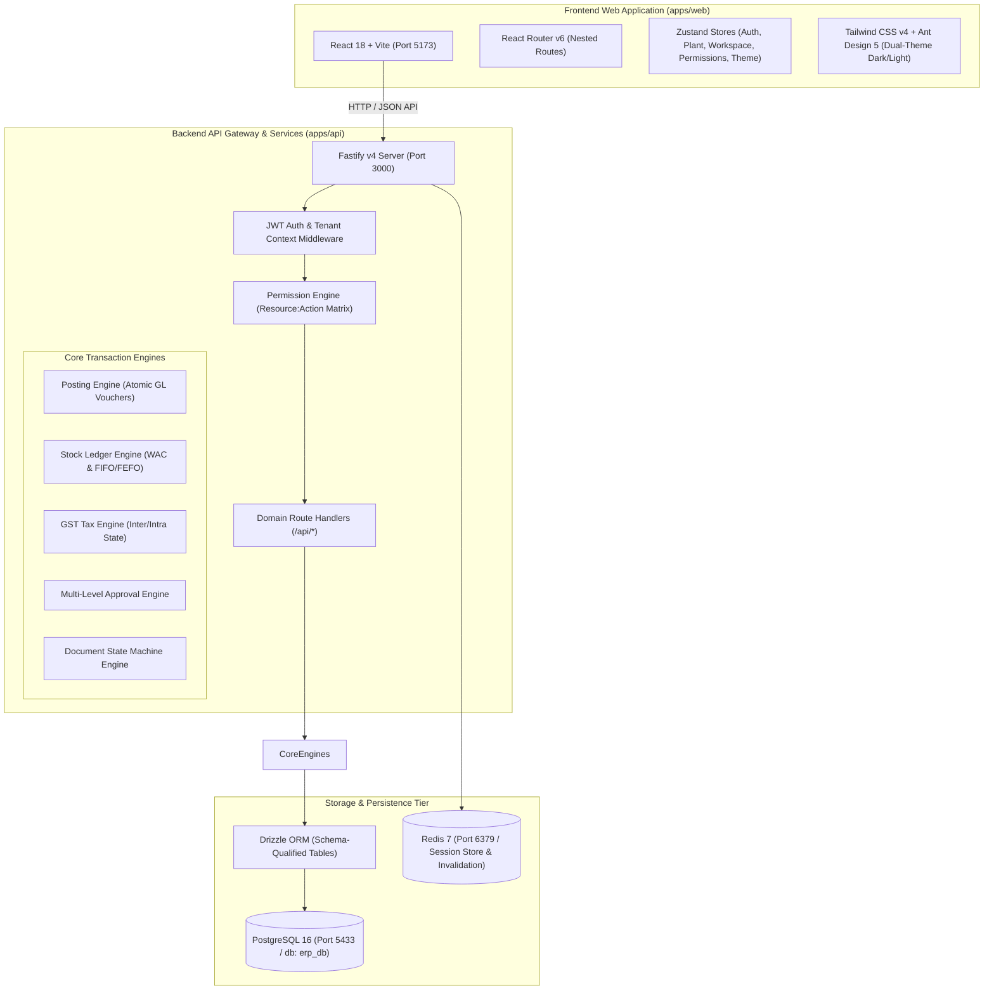

# Kairo ERP — Application Architecture & QA Automation Specification

**Document Version:** 1.0.0  
**Target Environment:** Development / Local Test Sandbox  
**Primary Tech Stack:** Fastify (Node.js/TypeScript), React 18 (Vite/Tailwind v4/AntD), PostgreSQL 16 (Drizzle ORM), Redis 7  
**Architecture Pattern:** Modular Monolith with Dynamic Industry Blueprints and Strict Invariant Engines  

---

## 1. High-Level Architecture Overview

Kairo ERP is architected as a high-performance modular monolith built around strict double-entry accounting, movement-based inventory, and multi-stage cost roll-up invariants.

---

## 2. Frontend Architecture (`apps/web`)

### 2.1 Framework & Build System
- **Framework:** React 18.3.1 with TypeScript 5.4.
- **Build Tool:** Vite 5.2.13 with `@vitejs/plugin-react` and `@tailwindcss/vite`.
- **Styling Architecture:** Dual-theme system adhering strictly to Tailwind CSS utility classes with `dark:` variants, accompanied by Ant Design 5 component primitives wrapped for consistent aesthetic harmony.
- **State Management:**
  - `useAuthStore` (`apps/web/src/store/auth.ts`): Manages authentication tokens, user profile, silent token refresh, and login/logout state purging.
  - `usePlantStore` (`apps/web/src/store/plant.ts`): Manages the currently selected active company and active plant context.
  - `usePermissionStore` (`apps/web/src/store/permission.ts`): Caches effective permissions for the current user in the active tenant/plant context.
  - `useWorkspaceStore` (`apps/web/src/store/workspace.ts`): Multi-tab tabbed workspace enabling power users to work across multiple vouchers simultaneously.

### 2.2 Routing & Navigation Structure
- Root Router: `apps/web/src/App.tsx`
  - `/login`: Public authentication page.
  - `/admin`: Super-admin console (guarded by `isSystemAdmin`).
  - `/select-company`: Tenant & plant selection portal (guarded by `ProtectedRoute`).
  - `/`: Main ERP shell (guarded by `PlantRoute` $\to$ `AppShell`).
    - `/dashboard`: Real-time operational KPIs, charts, quick links.
    - `/settings/*`: System configuration, companies, plants, users, roles, tax codes, COA, document number series.
    - `/masters/*`: Master records (suppliers, customers, items, item groups, units of measure).
    - `/purchase/*`: Procure-to-Pay transactional screens.
    - `/sales/*`: Order-to-Cash transactional screens.
    - `/inventory/*`: Stock balances, stock ledger, transfers, physical adjustments.
    - `/manufacturing/*`: BOM, work centers, production orders, subcontracting/job work.
    - `/accounting/*`: Journal vouchers, reports (P&L, Balance Sheet, Trial Balance, GST, Aging), project accounting, bank reconciliation.
    - `/reports/*`: Cross-module operational reports.
    - `/print/:docType/:id`: Standardized thermal and A4 print rendering engine.

---

## 3. Backend API Architecture (`apps/api`)

### 3.1 Server Engine
- **Framework:** Fastify v4.27.0 with `@fastify/jwt`, `@fastify/cookie`, `@fastify/cors`.
- **Runtime:** Node.js with `tsx watch` for hot-reload in development.
- **Configuration:** Loaded from root `.env` via `apps/api/src/config.ts`.
  - Default API port: `3000`.
  - Host: `0.0.0.0`.
  - CORS Origin: `http://localhost:5173`.

### 3.2 Authentication & Tenant Resolution Flow
1. **Login (`POST /api/auth/login`):**
   - Accepts identifier (`email`, `username`, or UUID) and password.
   - Verifies Argon2id password hash.
   - Enforces company seat licensing check (verifying concurrent active sessions against `company_license.max_users`).
   - Issues short-lived access JWT (15-minute expiration) and sets `httpOnly` secure refresh cookie (7-day expiration).
2. **Context Selection (`POST /api/auth/select-context`):**
   - Validates that the user is assigned to the requested `companyId` and `plantId` (or is a `isSystemAdmin`).
   - Stores `activeCompanyId` and `activePlantId` on the DB session record.
   - Reissues access JWT embedding `activeCompanyId` and `activePlantId`.
3. **Tenant Context Middleware (`apps/api/src/middleware/tenant-context.ts`):**
   - For all tenant-scoped endpoints, extracts `req.user.activeCompanyId`.
   - Never trusts client-supplied query/body parameters for company scoping, completely preventing multi-tenant data leaks.

### 3.3 Authorization & RBAC (`apps/api/src/services/permissions.ts`)
- Fine-grained permission strings formatted as `<module>.<resource>.<action>` (e.g. `purchase.order.create`, `sales.delivery.approve`).
- System administrators (`isSystemAdmin: true`) possess wild-card permission (`*`).
- Plant-level scoping allows users to view/transact only in authorized plants and warehouses.

---

## 4. Core Business Engines & Invariants

### 4.1 Movement-Based Stock Ledger Engine (`stock-ledger.ts`)
- **Strict Invariant:** No direct `UPDATE` on stock balances.
- Stock changes must insert an immutable row into `stock_ledger_entries`.
- Balances in `stock_balances` are maintained using row-level locking (`SELECT FOR UPDATE` on `(company_id, plant_id, warehouse_id, item_id, batch_id)`).
- **Valuation Method:** Moving Weighted Average Cost (WAC).
  $$\text{New WAC} = \frac{(\text{Current Qty} \times \text{Current WAC}) + (\text{Inward Qty} \times \text{Inward Rate})}{\text{Current Qty} + \text{Inward Qty}}$$
- Outward dispatches snap unit cost from the instant WAC and create balanced Cost of Goods Sold (COGS) journal lines.

### 4.2 Append-Only Double-Entry Posting Engine (`posting-engine.ts`, `posting-templates.ts`)
- Every transaction generating financial impact must write to `journal_entries` and `journal_entry_lines`.
- **Absolute Invariant:** $\sum \text{Debits} = \sum \text{Credits}$ checked to the exact paise ($1 \text{ INR} = 100 \text{ paise}$).
- Posted vouchers cannot be modified or deleted. Correction is strictly executed via reversal journals or credit/debit notes.
- Financial period locking: Posts into locked or closed fiscal periods are rejected with `PeriodLockedError`.

### 4.3 Tax Engine (`tax-engine.ts`)
- Automatically assesses Place of Supply (POS) against Company/Plant State.
- If intra-state: splits tax equally into CGST and SGST.
- If inter-state: books full tax into IGST.
- Handles Reverse Charge Mechanism (RCM) liabilities and Tax Deducted at Source (TDS).

---

## 5. Database Schema & Data Layer (`packages/db`)

### 5.1 Technology
- PostgreSQL 16 running in Docker (`erp-postgres-1` exposed on host port `5433`).
- Drizzle ORM v0.30.10 with declarative TypeScript schemas in `packages/db/src/schema/`.

### 5.2 Key Schema Groups
1. `auth.ts` / `company.ts`: `users`, `sessions`, `companies`, `plants`, `warehouses`, `company_users`.
2. `permissions.ts` / `approvals.ts`: `roles`, `permissions`, `user_roles`, `user_permissions`, `approval_workflows`.
3. `masters`: `items`, `item_groups`, `uom`, `suppliers`, `customers`, `tax_codes`, `chart_of_accounts`.
4. `purchase.ts`: `purchase_requisitions`, `blanket_purchase_orders`, `purchase_orders`, `goods_receipt_notes`, `landed_cost_vouchers`, `purchase_invoices`, `purchase_returns`, `debit_notes`.
5. `sales.ts`: `sales_quotations`, `sales_orders`, `stock_reservations`, `delivery_notes`, `sales_invoices`, `sales_returns`, `credit_notes`.
6. `inventory.ts`: `stock_ledger_entries`, `stock_balances`, `stock_transfers`, `stock_adjustments`, `item_batches`, `item_serials`.
7. `manufacturing.ts`: `work_centres`, `bom_headers`, `bom_lines`, `routings`, `production_orders`, `job_work_orders`, `job_work_challans`, `job_work_receipts`.
8. `accounting.ts`: `fiscal_years`, `fiscal_periods`, `journal_entries`, `journal_entry_lines`, `bank_accounts`, `bank_statements`, `projects`.

---

## 6. QA Automation Architecture Strategy

To deliver an autonomous, resilient, and enterprise-grade testing framework:
1. **Tri-Layer Verification Architecture:**
   - **UI Layer (Playwright):** Validates user interface flows, form interactions, error states, and responsive presentation.
   - **API Layer (Direct Fastify Client):** Validates status codes, contract payloads, error response structures, and business logic execution speed.
   - **Database Layer (Direct SQL Queries via Drizzle/pg):** Verifies physical row persistence, invariant enforcement, double-entry ledger balance ($\sum \text{Dr} = \sum \text{Cr}$), and append-only stock movement logs.
2. **Deterministic Test Isolation:**
   - Automated test data factories using unique run IDs (`TEST-<timestamp>-<hash>`).
   - Clean teardown mechanisms targeting only test-created records.
3. **AI-Ready QA Intelligence:**
   - Modular skill libraries storing domain operational runbooks.
   - Structured bug report generation with root cause hypotheses and actionable developer fix instructions.

