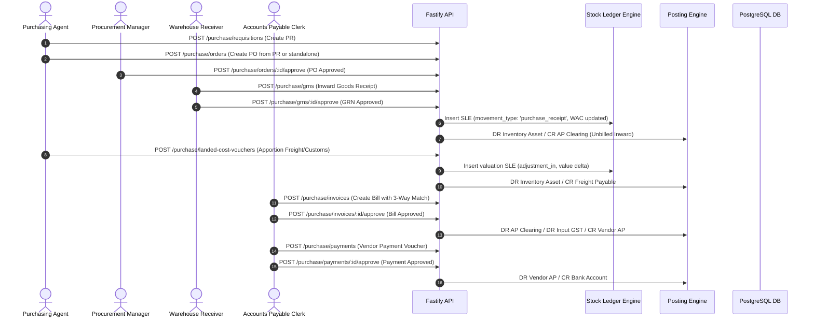
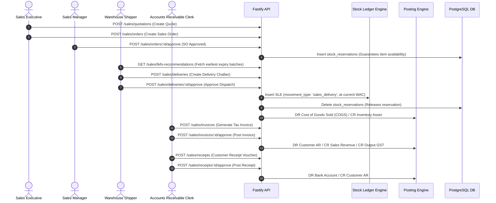
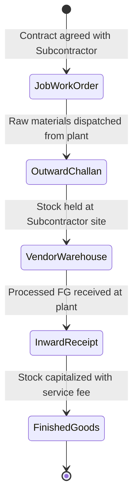

# Kairo ERP — Comprehensive Business Workflows & Execution Standards

**Document Version:** 1.0.0  
**Target:** Standard Operating Procedures (SOPs), Expected Calculations, State Transitions, and Test Scenarios.

---

## 1. Procure-to-Pay (P2P) Lifecycle

### 1.1 Complete Standard Workflow

### 1.2 Mathematical Assertions & Invariants
1. **Weighted Average Cost (WAC) Update:**
   Upon GRN approval:
   $$\text{New WAC} = \frac{(Q_{\text{prior}} \times \text{WAC}_{\text{prior}}) + (Q_{\text{receipt}} \times \text{Rate}_{\text{receipt}})}{Q_{\text{prior}} + Q_{\text{receipt}}}$$
2. **Double-Entry Equilibrium:**
   - GRN: $\text{Debit (Inventory Asset)} = \text{Credit (AP Clearing)}$
   - Invoice: $\text{Debit (AP Clearing)} + \text{Debit (Input CGST/SGST/IGST)} = \text{Credit (Vendor AP)} + \text{Credit (TDS)}$
   - Payment: $\text{Debit (Vendor AP)} = \text{Credit (Bank/Cash Account)}$
3. **Partial Receipts & Invoicing:**
   - When GRN $Q < \text{PO } Q$, PO `receipt_status` becomes `'partial'`.
   - When Invoice $Q < \text{PO } Q$, PO `billing_status` becomes `'partial'`.
   - When all quantities are received and billed, status transitions to `'completed'`.

---

## 2. Order-to-Cash (O2C) Lifecycle

### 2.1 Complete Standard Workflow

### 2.2 Direct Counter POS / Quick Invoice Workflow
- `POST /api/sales/quick-invoice`:
  - Executes dispatch, invoice, and cash collection **in a single ACID database transaction**.
  - Atomically writes:
    1. Outward SLE (`movement_type: 'sales_delivery'`).
    2. Revenue GL: **DR** Customer/Cash $\to$ **CR** Sales Revenue + Output GST.
    3. COGS GL: **DR** COGS Expense $\to$ **CR** Inventory Asset (at current WAC).
    4. Receipt GL: **DR** Cash/Bank $\to$ **CR** Customer AR.

---

## 3. Subcontracting & Outside Job Work Lifecycle (GAP 4)

### 3.1 Business Lifecycle

### 3.2 Operational Steps & Accounting Invariants
1. **Job Work Order (JWO):**
   - Specifies target output item, expected quantity, required input items (BOM explosion), designated subcontractor vendor, and agreed processing rate per unit.
2. **Outward Material Challan (`POST /api/manufacturing/job-work-challans`):**
   - Physically transfers raw components from the plant's raw material warehouse to the **Vendor Virtual Warehouse**.
   - Movement: `movement_type = 'subcon_issue'`.
   - Asset ownership remains on company books (tagged under vendor's virtual warehouse location).
3. **Inward Finished Goods Receipt (`POST /api/manufacturing/job-work-receipts`):**
   - Consumes raw materials from Vendor Virtual Warehouse (`movement_type = 'issue_to_production'`).
   - Receives processed finished goods into plant warehouse (`movement_type = 'subcon_receipt'`).
   - **Cost Capitalization Formula:**
     $$\text{FG Valuation} = \sum (\text{Consumed Raw Material Qty} \times \text{WAC}) + \text{Total Vendor Service Charge}$$
   - **Balanced GL Voucher:**
     - **DR** Finished Inventory Asset ($\text{FG Valuation}$)
     - **CR** Raw Material Inventory Asset (Consumed amount)
     - **CR** Subcontractor Service Payable / AP Clearing (Contracted fee)

---

## 4. Manufacturing & Multi-Stage Routing Lifecycle

1. **BOM Configuration:**
   - Header defines target item and batch yield.
   - Lines define child component item, quantity, scrap percentage, and optional routing stage sequence.
2. **Production Order Execution:**
   - Step 1 (Material Issue): Raw stock is issued from warehouse to WIP (`movement_type: 'issue_to_production'`). GL: **DR** WIP Asset $\to$ **CR** Raw Material Asset.
   - Step 2 (Shopfloor Operation Completion): Tracks machine runtime and labor hours at each work center. GL: **DR** WIP Asset $\to$ **CR** Labor/Machine Overhead Absorption.
   - Step 3 (Finished Goods Receipt): Completes order. Calculates unit cost including materials, labor, and machine costs. GL: **DR** Finished Inventory Asset $\to$ **CR** WIP Asset.

---

## 5. Inventory Transfers & Physical Adjustments

1. **Inter-Plant Stock Transfers:**
   - Step 1: Transfer created and approved.
   - Step 2: Dispatched from Source Warehouse to **Transit Warehouse** (`movement_type: 'transfer_issue'`).
   - Step 3: Received at Destination Warehouse from Transit Warehouse (`movement_type: 'transfer_receipt'`).
   - Invariant: Goods in transit remain visible on company balance sheet under transit warehouse code.
2. **Stock Adjustments & Write-Offs:**
   - Physical count discrepancies require adjustment voucher.
   - Positive Adjustment: **DR** Inventory Asset $\to$ **CR** Stock Adjustment Gain.
   - Negative Adjustment / Scrap: **DR** Stock Adjustment Expense / Scrap Loss $\to$ **CR** Inventory Asset.

---

## 6. Financial Year & Period Closing Workflow

1. Fiscal year configured in `fiscal_years` with 12 monthly `fiscal_periods`.
2. Financial Period Lock:
   - When a period is closed or locked, `PostingEngine` throws `PeriodLockedError` on any attempt to post backdated documents.
   - Super-Admin override requires dedicated audit justification.
3. Bank Reconciliation (GAP 10):
   - Bank statement lines ingested via CSV/API into `bank_statement_lines`.
   - Matching engine correlates statement lines with `journal_entry_lines` by date, reference/UTR number, and exact amount.
   - Auto-reconciled items marked with `reconciled_at` and `reconciled_by`.

