# Kairo ERP — Cross-Module Dependency Map & Integration Topology

**Document Version:** 1.0.0  
**Focus:** Entity relationships, transactional flow hierarchies, and GL/SLE cross-module integration hooks.

---

## 1. System Module Dependency Hierarchy

The ERP system operates on a strict layered dependency hierarchy. No transaction in a higher tier can be created without established records in lower tiers:

```mermaid
graph TD
    subgraph Tier0 ["Tier 0: Infrastructure & Security"]
        Auth["Authentication & Sessions"]
        Company["Companies & Licensing"]
        Plants["Plants & Warehouses"]
        COA["Chart of Accounts (COA)"]
    end

    subgraph Tier1 ["Tier 1: Master Data Layer"]
        Items["Items, UOM & Conversions"]
        Suppliers["Suppliers / Vendors"]
        Customers["Customers & Credit Limits"]
        Tax["Tax Codes & Rules"]
        Projects["Projects (GAP 8)"]
    end

    subgraph Tier2 ["Tier 2: Upstream Procurement & Demand"]
        PR["Purchase Requisitions"]
        BPO["Blanket Purchase Orders (GAP 7)"]
        PO["Purchase Orders"]
        Quotations["Sales Quotations"]
        SO["Sales Orders"]
        BOM["Bill of Materials (BOM)"]
    end

    subgraph Tier3 ["Tier 3: Execution & Physical Movements"]
        GRN["Goods Receipt Notes (Inward)"]
        LCV["Landed Cost Vouchers (GAP 3)"]
        Dispatch["Delivery Challans (Outward)"]
        WorkOrder["Production Orders (Shopfloor)"]
        JobWork["Subcontracting / JWO (GAP 4)"]
        Transfers["Stock Transfers (Transit WH)"]
        Adjustments["Stock Adjustments"]
    end

    subgraph Tier4 ["Tier 4: Financial Billing & Settlement"]
        PI["Purchase Invoices (Bills)"]
        SI["Sales Invoices (Tax Invoices)"]
        QuickInv["Quick Invoice POS"]
        Payments["Vendor Payments"]
        Receipts["Customer Receipts"]
        Returns["Purchase & Sales Returns"]
        Notes["Debit & Credit Notes"]
        BankRec["Bank Reconciliation (GAP 10)"]
    end

    subgraph Tier5 ["Tier 5: Core Financial Truth & BI"]
        SLE[("Stock Ledger Entries (Movement Truth)")]
        GL[("General Ledger Entries (Financial Truth)")]
        Reports["Financial & Inventory Reports"]
    end

    Tier0 --> Tier1
    Tier1 --> Tier2
    Tier2 --> Tier3
    Tier3 --> Tier4
    Tier3 --> Tier5
    Tier4 --> Tier5
```



---

## 2. Transactional Dependency Matrices

### 2.1 Procure-to-Pay (P2P) Flow & Linkages

| Document | Parent Dependency | Creates / Impacts | GL Impact | Stock Ledger Impact |
|---|---|---|---|---|
| **Purchase Requisition (PR)** | Department, Items | Open Requisition Lines | None | None |
| **Blanket PO (BPO)** | Supplier, Items | Master Contract Rate & Quota | None | None |
| **Purchase Order (PO)** | Supplier, Items, (Optional PR/BPO) | Authorized Order Quota | None | None |
| **Goods Receipt Note (GRN)** | Approved PO, Warehouse | Inward Receipt | **DR** Inventory Asset<br>**CR** AP Clearing | **IN** `purchase_receipt` (Calculates new WAC) |
| **Landed Cost Voucher (LCV)** | Posted GRN | Unit Valuation Apportionment | **DR** Inventory Asset<br>**CR** Freight/Customs Payable | **IN** `adjustment_in` (Zero qty, value delta) |
| **Purchase Invoice (Bill)** | Approved GRN / PO | Accounts Payable Liability | **DR** AP Clearing<br>**DR** Input GST<br>**CR** Vendor AP | None |
| **Vendor Payment** | Approved Purchase Invoice | Bank / Cash Settlement | **DR** Vendor AP<br>**CR** Bank Account | None |
| **Purchase Return (RTV)** | Approved GRN / PO | Defective Stock Return | **DR** AP Clearing / Vendor AP<br>**CR** Inventory Asset | **OUT** `return_to_vendor` (At snapped WAC) |
| **Debit Note** | Approved Purchase Invoice | Vendor Balance Reduction | **DR** Vendor AP<br>**CR** Asset / Expense | None |

---

### 2.2 Order-to-Cash (O2C) Flow & Linkages

| Document | Parent Dependency | Creates / Impacts | GL Impact | Stock Ledger Impact |
|---|---|---|---|---|
| **Sales Quotation** | Customer, Items | Formal Proposal | None | None |
| **Sales Order (SO)** | Customer, Items, (Optional Quote) | Customer Commitment | None | Inserts row into `stock_reservations` |
| **Delivery Challan (DC)** | Approved SO, Warehouse | Physical Shipment | **DR** Cost of Goods Sold (COGS)<br>**CR** Inventory Asset | **OUT** `sales_delivery` (Releases `stock_reservations`) |
| **Sales Invoice** | Approved DC / SO | Accounts Receivable Asset | **DR** Customer AR<br>**CR** Sales Revenue<br>**CR** Output GST | None |
| **Customer Receipt** | Approved Sales Invoice | Cash / Bank Inflow | **DR** Bank Account<br>**CR** Customer AR | None |
| **Quick Invoice (POS)** | Customer (or Walk-in), Items | Direct Counter Sale | Atomic: **DR** Cash/AR, **DR** COGS, **CR** Revenue, **CR** Tax, **CR** Inventory | **OUT** `sales_delivery` (Atomic deduction) |
| **Sales Return** | Approved Invoice / DC | Customer Inward Return | **DR** Inventory Asset<br>**CR** COGS | **IN** `return_from_customer` (At original WAC) |
| **Credit Note** | Approved Sales Invoice | Receivable Reduction | **DR** Sales Revenue / Discount<br>**CR** Customer AR | None |

---

### 2.3 Manufacturing & Subcontracting Flow & Linkages

| Document | Parent Dependency | Creates / Impacts | GL Impact | Stock Ledger Impact |
|---|---|---|---|---|
| **Bill of Materials (BOM)** | FG Item, Raw Components | Assembly Structure | None | None |
| **Work Center** | Plant | Capacity & Hourly Cost | None | None |
| **Production Order (PO)** | BOM, Plant, Warehouses | Shopfloor Execution Order | None | None |
| **Material Issue** | Production Order | Raw Stock to WIP | **DR** WIP Asset<br>**CR** Raw Material Inventory | **OUT** `issue_to_production` |
| **Routing Operation Complete** | Production Order, Work Center | Runtime & Labor Absorption | **DR** WIP Asset<br>**CR** Labor & Machine Absorption | None |
| **FG Production Receipt** | Production Order | Finished Inventory Receipt | **DR** FG Inventory<br>**CR** WIP Asset | **IN** `production_receipt` (Calculates unit roll-up cost) |
| **Job Work Order (JWO)** | Subcontractor, BOM/Components | Outside Processing Contract | None | None |
| **Job Work Outward Challan** | Approved JWO | Physical Transfer to Vendor | None (Asset remains company owned) | **OUT** `subcon_issue` (Source WH) $\to$ **IN** Vendor WH |
| **Job Work Inward Receipt** | Approved JWO, Vendor WH | Inward Finished Goods | **DR** FG Inventory<br>**CR** Vendor WH Raw Stock<br>**CR** Subcon Service Payable | **OUT** `issue_to_production` (Vendor WH) $\to$ **IN** `subcon_receipt` (Plant WH) |

---

## 3. Database Foreign Key & Integrity Relationships

```
companies (Root Tenant)
 ├── company_license (1:1)
 ├── plants (1:N)
 │    ├── warehouses (1:N)
 │    │    ├── stock_balances (1:N)
 │    │    └── stock_ledger_entries (1:N)
 │    └── work_centres (1:N)
 ├── chart_of_accounts (1:N)
 │    └── journal_entry_lines (1:N)
 ├── users (N:M via company_users)
 ├── suppliers (1:N)
 │    ├── blanket_purchase_orders (1:N)
 │    ├── purchase_orders (1:N)
 │    └── purchase_invoices (1:N)
 ├── customers (1:N)
 │    ├── sales_quotations (1:N)
 │    ├── sales_orders (1:N)
 │    └── sales_invoices (1:N)
 └── items (1:N)
      ├── bom_headers (1:N)
      └── stock_balances (1:N)
```

---

## 4. Multi-Tenant & Multi-Plant Isolation Rules

1. **Company Boundary (`company_id`):** Every domain query must incorporate `WHERE company_id = :activeCompanyId`. Cross-tenant queries are blocked at both DB and API middleware layers.
2. **Plant Boundary (`plant_id`):** Users restricted to specific plants cannot create POs, SOs, or GRNs in plants outside their authorized `user_plant_access` records.
3. **Warehouse Boundary (`warehouse_id`):** Physical stock entries must reference warehouses tied directly to the document's plant.

