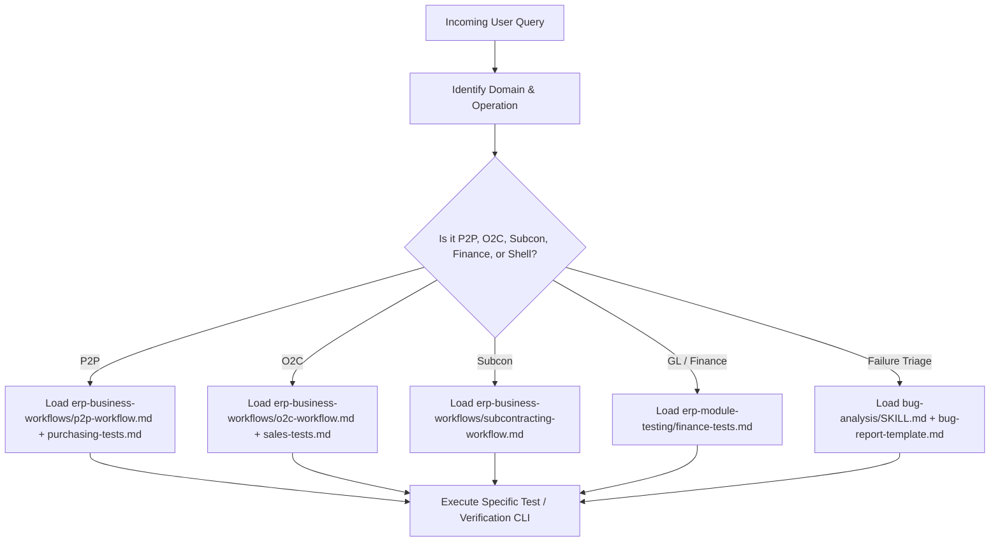

# Kairo ERP — Task-to-Skill Selector Index (Token Optimization)

Use this lookup matrix to select the minimal set of skills to load for any given engineering or QA task.

| Task Category | User / Agent Objective | Skills to Load | Estimated Token Cost |
|---|---|---|---|
| **P2P Testing / Bugfix** | Test or debug Requisitions, PO, GRN, LCV, Invoices, Payments | `erp-application-knowledge` `erp-business-workflows/p2p-workflow.md` `erp-module-testing/purchasing-tests.md` `playwright-automation` | ~2,500 tokens |
| **O2C Testing / Bugfix** | Test or debug Quotations, SO, FEFO, Deliveries, Quick Invoice, AR | `erp-application-knowledge` `erp-business-workflows/o2c-workflow.md` `erp-module-testing/sales-tests.md` `playwright-automation` | ~2,500 tokens |
| **Subcontracting (GAP 4)** | Test or debug Outside Job Work Orders, Challans, Receipts, Capitalization | `erp-application-knowledge` `erp-business-workflows/subcontracting-workflow.md` `bug-analysis` | ~2,200 tokens |
| **Accounting & General Ledger** | Validate COA, balanced JVs, Bank Reconciliation (GAP 10), Project Accounting (GAP 8) | `erp-application-knowledge` `erp-module-testing/finance-tests.md` `regression-testing` | ~2,300 tokens |
| **Defect Triage & Investigation** | Investigate a test failure, establish root cause, author bug report | `bug-analysis` `erp-business-workflows` `playwright-automation` | ~2,800 tokens |
| **Full Regression Execution** | Execute end-to-end regression across all modules and verify reports | `regression-testing` `playwright-automation` | ~1,800 tokens |
| **Deep Financial & Inventory Validation** | Validate multi-tier double entry ($\sum \text{Dr} = \sum \text{Cr}$), GRNI clearing, COGS, WAC, AP/AR subledgers | `erp-financial-validation` `erp-accounting-and-gl` `erp-inventory-and-valuation` | ~2,100 tokens |
| **Master Data Maintenance** | Add or modify Items, UOM, Suppliers, Customers, Warehouses | `erp-application-knowledge` `erp-module-testing` | ~1,900 tokens |
| **UI Automation Enhancement** | Build new Page Object Models, custom locators, or interactive tests | `playwright-automation` `erp-application-knowledge/module-inventory.md` | ~2,400 tokens |

---

## Loading Decision Protocol

